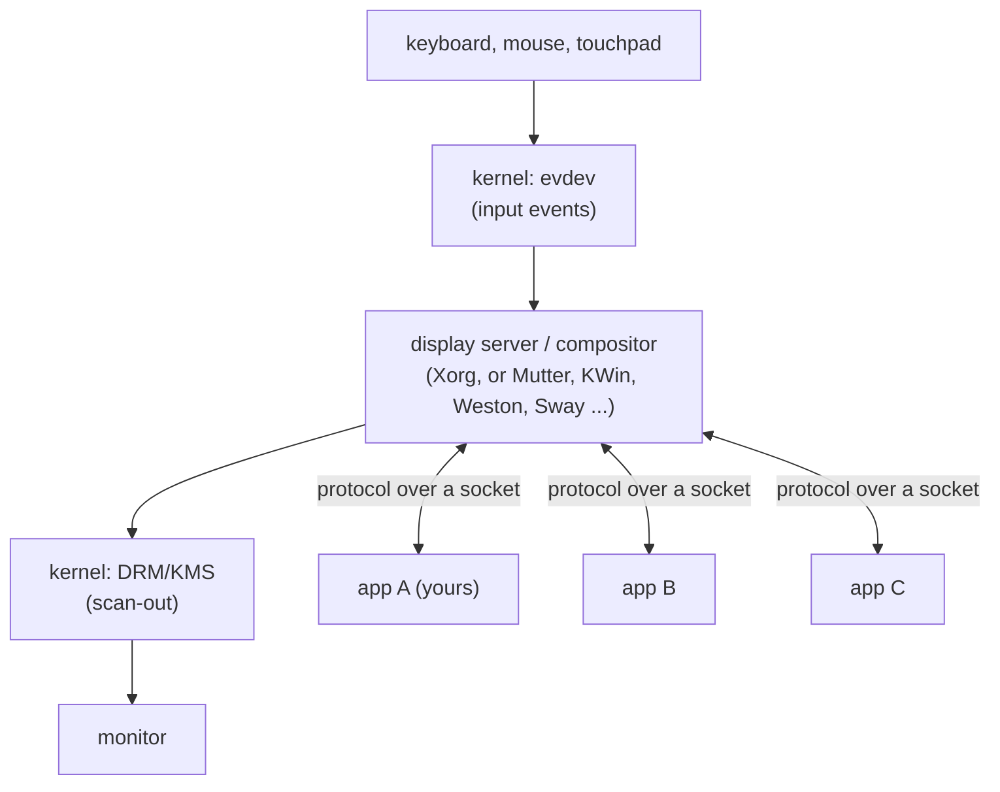
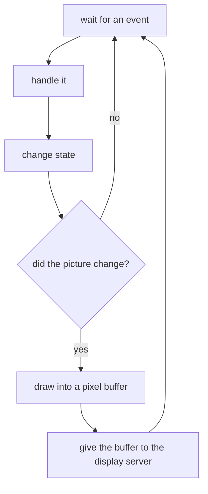

# Chapter 1. How a window appears on a Linux screen

**You will learn**

- What sits between your program and the pixels on the monitor
- The difference between a display server, a compositor and a window manager
- Why X11 and Wayland feel so different to program, and what they share
- The two ideas the whole book is built on: an event loop and a pixel buffer

**Code for this chapter:** none yet. Chapter 2 sets up the tools, and chapter 3 opens the first window.

---

## 1.1 The problem

On Windows you call `CreateWindow` and the operating system gives you a window with a title bar, borders, a close button and a message queue. On macOS you call AppKit. On Linux there is no single answer, and that is the first thing to understand. The kernel knows about graphics cards and input devices. It does not know what a "window" is.

Everything that makes a window a window is user space software, and there are several competing pieces. If you have only ever used Qt or GTK, they hid all of this from you. We are going to build on the layer underneath them.

## 1.2 The layers

Here is the path from a key press to a changed pixel on a typical Ubuntu desktop.



Reading from the bottom of the stack up:

- **The kernel** exposes input devices as `/dev/input/event*` (the evdev interface) and graphics hardware through DRM (Direct Rendering Manager) and KMS (Kernel Mode Setting). Your application almost never touches these directly. Only the display server does.
- **The display server** owns the screen and the input devices. Applications connect to it over a Unix domain socket and speak a protocol: "create a window", "here are my pixels", "the user pressed a key".
- **Your application** is a client. It sends requests, receives events, and draws its own contents.

The protocol is the contract. X11 is one protocol and Wayland is another. Chapters 3 to 5 teach the X11 one and chapters 6 and 7 teach the Wayland one.

## 1.3 Three jobs that are easy to confuse

Three roles appear in every desktop. In X11 they are three programs. In Wayland they are usually merged into one.

| Role | What it does | X11 | Wayland |
|---|---|---|---|
| **Display server** | Talks to the hardware, routes input to windows | Xorg | part of the compositor |
| **Compositor** | Combines every window's pixels into the final image, adds shadows, animations, transparency | optional add-on (picom, or built into the window manager) | the core of the whole system |
| **Window manager** | Decides where windows go, draws title bars and borders, handles move, resize, minimize, focus | a separate program (Mutter, KWin, i3 ...) | part of the compositor |

On Ubuntu with GNOME the Wayland session runs **Mutter**, which is display server, compositor and window manager at once. The X11 session runs Xorg plus Mutter acting as window manager and compositor.

Why this matters to you as a programmer:

- Under X11, the **window manager draws your title bar**. You never see it. You ask nicely, through window properties, for a title and a minimum size.
- Under Wayland, **who draws the title bar depends on the compositor**. KDE and Sway will draw it for you (server side decorations). GNOME will not, so a bare Wayland window has no title bar at all unless your program draws one (client side decorations). Chapter 7 shows both paths.

## 1.4 X11 in one page

X11 dates from 1984. Its model is a **network transparent drawing server**.

- The server holds a tree of windows. Your program creates windows in that tree.
- You can ask the server to draw for you ("fill this rectangle", "draw this text"). Modern programs rarely do. They draw into their own memory and ask the server to copy it.
- Events are delivered to windows you have selected interest in (`XSelectInput`).
- Any client can see and manipulate any other client's windows. This is how window managers and screenshot tools work, and why X11 has weak security isolation between applications.
- Output is not synchronised with the monitor refresh unless you take extra steps. This is the root cause of "tearing" and one reason Wayland exists.

## 1.5 Wayland in one page

Wayland (2008) starts from the opposite assumption: **every window is a private buffer**.

- The client draws a complete image into a buffer, usually shared memory, and tells the compositor "this is the new contents of my surface". The compositor reads it and puts it on screen.
- There is no tree of windows to reach into. One client cannot see another's pixels or inject events into it. Isolation is the default.
- The protocol is a small core plus **extensions**. Almost everything useful (`xdg-shell` for desktop windows, `xdg-decoration`, clipboard, cursors) lives in an extension that the compositor may or may not offer. Your program must ask at start up what is available.
- The compositor decides when to show your buffer. It tells you when it is a good time to draw the next frame (frame callbacks), which gives tear free output.
- The protocol is **object oriented and asynchronous**. You create proxy objects, attach listeners to them, and the compositor calls you back.

## 1.6 What both systems have in common

Strip away the differences and a windowed program is always the same loop:



This is the **event loop plus pixel buffer** model. Whatever the toolkit, this is what runs underneath. It gives us two promises we keep throughout the book:

1. **Sleep when there is nothing to do.** An idle window must use no CPU. We block in `poll` or `XNextEvent` until something happens.
2. **Draw only when something changed.** Redrawing 60 times per second for a static form is wasteful and is a classic beginner mistake.

## 1.7 The helper libraries we use

The book avoids anything with its own widget system. We use these low level libraries, each of which does one job:

| Library | Job |
|---|---|
| **Xlib** (and a little xcb) | Talk the X11 protocol |
| **libwayland-client** | Talk the Wayland protocol |
| **libxkbcommon** | Turn raw key codes into characters, using the user's keyboard layout |
| **Cairo** | Draw anti-aliased 2D shapes into a pixel buffer |
| **Pango** | Lay out and shape text (fonts, kerning, scripts, bidirectional text) |

Notice what is not here: no SDL, GLFW, Qt, GTK or ImGui. SDL and GLFW would be legitimate to use in a real project, but they would hide exactly the layer this book exists to teach.

## 1.8 Which session am I running?

Ubuntu offers both session types at the login screen. You can check which one you are in:

```
echo $XDG_SESSION_TYPE
```

It prints `x11` or `wayland`. Two environment variables decide where a program connects:

- `DISPLAY`, for example `:0`, names the X server.
- `WAYLAND_DISPLAY`, for example `wayland-0`, names the Wayland compositor socket (found in `$XDG_RUNTIME_DIR`).

A Wayland session usually also runs **XWayland**, an X server that appears as a Wayland client, so `DISPLAY` is set as well. That lets old X11 programs run. It also means that on a Wayland desktop you can test your X11 code. We will lean on this in chapter 2.

## 1.9 A note on terminology

- **Surface** is Wayland's word for a rectangle of pixels. A window is a surface with a role.
- **Drawable** is X11's word for something you can draw to (a window or a pixmap).
- **Framebuffer** in this book means our own block of memory that holds the pixels of one frame. (Do not confuse it with the kernel's `/dev/fb0`.)
- **Client** is your program. **Server** is the display server or compositor.

## Pitfalls

- *"Wayland replaced X11, so I only need Wayland."* Not yet. Many users, remote desktops, older software and some drivers still use X11, and XWayland is a compatibility layer, not a native path. Supporting both is the point of this book.
- *"X11 draws my title bar."* The window manager does. If it looks wrong, your program is not the cause.
- *"I will get the mouse position from the kernel."* On both systems the display server owns input. Clients only hear about the pointer when it is over their window, unless they ask for special access.

## Review questions

1. Name the three roles (display server, compositor, window manager). Which program fills each under an X11 session on Ubuntu, and which program fills them all under a GNOME Wayland session?
2. Why can a screenshot tool see every window on X11, but need special permission on Wayland?
3. Who draws the title bar of a window on KDE Wayland? On GNOME Wayland?
4. State the two promises of the event loop model.
5. What is XWayland, and why does it help you while learning?

## Exercises

**Ex 1.1** Run `echo $XDG_SESSION_TYPE $DISPLAY $WAYLAND_DISPLAY` in a terminal. Write down the three values and explain what each tells you.

**Ex 1.2** Find the Wayland socket on your machine. Where does it live, and what are its permissions?

**Ex 1.3** Run `xdpyinfo | head -20` (package `x11-utils`). Which parts of the output describe the server, and which describe the screen?

**Ex 1.4** On a Wayland session, run `xeyes` (package `x11-apps`) and move the cursor over a native Wayland window, then over an X11 window. Explain what you observe about XWayland and pointer visibility.

Solutions: [solutions/ch01.md](solutions/ch01.md)

Next: [Chapter 2, the toolchain](02-toolchain-and-environment.md)
