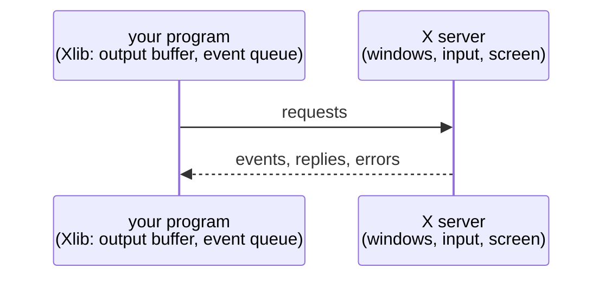

# Chapter 3. Your first X11 window

**You will learn**

- How an Xlib program connects to the server and creates a window
- Why requests are buffered, and when they are actually sent
- How a program and the window manager talk through properties and client messages
- Why closing a window needs `WM_DELETE_WINDOW`

**Code for this chapter:** `p01_x11_window/main.cpp` (94 lines).

---

## 3.1 The client/server model in practice

An X program does not call into a graphics driver. It opens a socket to the X server and writes **requests**. The server writes back **replies** (to requests that ask a question), **events** (things that happened) and **errors** (a request failed).



Xlib keeps an **output buffer**. `XCreateWindow`, `XMapWindow` and friends append bytes to it and return immediately. Nothing is sent until the buffer is flushed. Three things flush it:

- `XFlush(dpy)`, which sends the buffer and does not wait.
- `XSync(dpy, False)`, which sends the buffer and waits until the server has processed everything.
- Any call that must wait for a reply, and `XNextEvent` when the queue is empty.

This is why code that "does nothing" without an `XFlush` is a classic beginner trap, and why errors from a bad request show up later, in a different call, than the line that caused them.

## 3.2 Walking through the program

Open `p01_x11_window/main.cpp` and follow along.

### Connect

```cpp
Display* dpy = XOpenDisplay(nullptr);
```

`nullptr` means "read `$DISPLAY`". A `Display*` is the whole connection: socket, buffers, and some cached facts about the server. If it returns null, print the reason and exit.

### Identify the screen and root window

```cpp
const int screen = DefaultScreen(dpy);
Window root = RootWindow(dpy, screen);
```

A server may drive several screens, and every screen has a **root window** that covers it. All your windows are descendants of a root. The macros come from a time before multi monitor desktops. Today one screen spans all monitors (via the RandR extension), so you can nearly always use the default.

### Create the window

```cpp
Window win = XCreateSimpleWindow(dpy, root,
                                 0, 0, width, height,
                                 0,                         // border width
                                 BlackPixel(dpy, screen),   // border colour
                                 background);               // background colour
```

A `Window` is just a 32 bit id number (an XID). The server owns the real object, and you refer to it by id in every request. Keep that in mind: **ids, not pointers**, is how the X protocol works.

The position arguments are advisory. The window manager decides where the window really goes. The background colour is painted by the server whenever part of the window is exposed. We use `0xRRGGBB`, which is correct on the usual 24 bit TrueColor visual. (A *visual* describes how pixel values map to colours. Chapter 5 checks this properly.)

### Title

```cpp
XStoreName(dpy, win, title);
// plus _NET_WM_NAME as UTF8_STRING
```

`XStoreName` sets the old `WM_NAME` property, which is Latin-1. Modern window managers read `_NET_WM_NAME` (UTF-8). The program sets both. A **property** is a named, typed blob attached to a window, stored in the server. Names are interned into **atoms** (small integers) by `XInternAtom`, because comparing integers is cheaper than comparing strings on every message.

You can see all of a window's properties with `xprop`. Run it, click your window, and look for `WM_NAME`, `_NET_WM_NAME` and `WM_NORMAL_HINTS`.

### Size hints

```cpp
XSizeHints hints{};
hints.flags = PMinSize;
hints.min_width = 200;
hints.min_height = 120;
XSetWMNormalHints(dpy, win, &hints);
```

The window manager enforces these. Set a flag for each field you fill in, or the field is ignored.

### Closing: WM_DELETE_WINDOW

```cpp
Atom wmDeleteWindow = XInternAtom(dpy, "WM_DELETE_WINDOW", False);
XSetWMProtocols(dpy, win, &wmDeleteWindow, 1);
```

When the user clicks the close button, the window manager does not know whether your program has unsaved work. The old default is to destroy your window and kill your connection. By listing `WM_DELETE_WINDOW` as a supported protocol you tell the manager: do not kill me, send a message and let me decide. The message arrives as a `ClientMessage` event:

```cpp
case ClientMessage:
    if (static_cast<Atom>(ev.xclient.data.l[0]) == wmDeleteWindow) running = false;
```

This is the polite handshake that every real application implements. Without it, closing the window ends the program with `X connection broken` and no chance to clean up.

### Choose events

```cpp
XSelectInput(dpy, win, StructureNotifyMask | ExposureMask);
```

The server sends you only the events you ask for. Here, `StructureNotifyMask` gives window structure changes (resize, map, unmap, move, as `ConfigureNotify` and friends) and `ExposureMask` gives `Expose`. Chapter 4 adds keyboard and mouse.

### Map

```cpp
XMapWindow(dpy, win);
XFlush(dpy);
```

A new window is invisible until **mapped**. Map is a request, not a command: with a window manager running, the manager gets a chance to intercept it, add its title bar and borders (it **reparents** your window into a frame it owns) and finally show it. That is how X11 decorations work, and why your `x,y` request is often overridden.

### The event loop

```cpp
while (running) {
    XEvent ev;
    XNextEvent(dpy, &ev);   // blocks
    switch (ev.type) { ... }
}
```

`XNextEvent` sleeps until an event arrives. This is the first of our two promises: no CPU when idle. `XEvent` is a union of all event structs, and you read the member that matches `ev.type`.

### Clean up

```cpp
XDestroyWindow(dpy, win);
XCloseDisplay(dpy);
```

On exit the server would clean up for you, but explicit cleanup keeps leak checkers quiet and is a good habit once you hold more resources.

## 3.3 Expose and the paint model

When part of your window was covered and uncovered, or when the window first appears, the server sends an `Expose` event meaning "this region has lost its contents, please repaint". In stage 1 there is nothing to repaint because the server fills the background colour itself.

Real X11 programs historically drew only in response to `Expose`. In our design (chapter 8) we draw whenever our own state says something changed, and treat `Expose` as one more reason to redraw. Keep the older rule in mind, because it explains why resizing a window and then seeing garbage means you ignored an Expose.

## 3.4 Run it

```
./build/gcc-debug/p01_x11_window/p01_x11_window
```

Try these:

- Drag the window edge. The terminal prints `resized to WxH`.
- Try to shrink it below 200x120. The manager refuses.
- Click close. The program exits cleanly with status 0.
- Comment out the `XSetWMProtocols` line, rebuild, and close the window. Compare. You will see an X connection error. That shows what the handshake is for.

On a Wayland desktop this runs through XWayland and looks like any other window, although some things (for example HiDPI scaling) may behave differently.

## Pitfalls

- **No `XFlush`.** If the window never appears and the program seems stuck, you are probably waiting on a request that was never sent.
- **Forgetting `XSelectInput`.** No events means a program that never reacts. Every event type has its own mask.
- **Ignoring `Expose`'s `count` field.** One repaint can generate several Expose events. Only the one with `count == 0` is the last.
- **Treating `XSizeHints` flags as optional.** Without `PMinSize` set, the min values are ignored.
- **Calling Xlib from several threads** without `XInitThreads()`. Xlib is not thread safe by default.
- **Error handler surprises.** Xlib's default error handler prints a message and calls `exit`. Install your own with `XSetErrorHandler` when you probe things that may fail (chapter 5 does).

## Review questions

1. What is a `Window` in Xlib terms? Is it a pointer?
2. What happens between `XMapWindow` and the window appearing, if a window manager is running?
3. Why do we set both `WM_NAME` and `_NET_WM_NAME`?
4. Which three kinds of call flush the output buffer?
5. What does `XSetWMProtocols` with `WM_DELETE_WINDOW` change about how the close button works?

## Exercises

**Ex 3.1** Change the background colour and size. Then use `xwininfo` to confirm the size the server reports.

**Ex 3.2** Add `KeyPressMask` to `XSelectInput` and quit when the Escape key is pressed. (You may use `XLookupKeysym(&ev.xkey, 0) == XK_Escape`, from `<X11/keysym.h>`. Chapter 4 explains why this is not the best way.)

**Ex 3.3** Set a title with a non ASCII character, for example an accented letter. Check `xprop _NET_WM_NAME` shows it correctly. Then remove the `_NET_WM_NAME` code and see what happens in your window manager's title bar.

**Ex 3.4** Create two windows in the same program. Quit only when both have been closed. Hint: remember which window each `ClientMessage` came from (`ev.xclient.window`).

**Ex 3.5** Add `XSetWMProperties` or `XSetClassHint` to set the window class. Use `xprop WM_CLASS` to verify. Why do desktop environments care about the class?

Solutions: [solutions/ch03.md](solutions/ch03.md)

Previous: [Chapter 2](02-toolchain-and-environment.md) | Next: [Chapter 4, events and keyboard](04-x11-events-and-keyboard.md)
