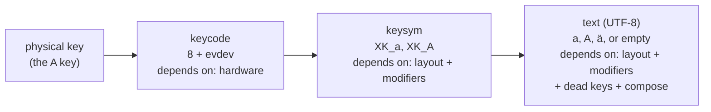
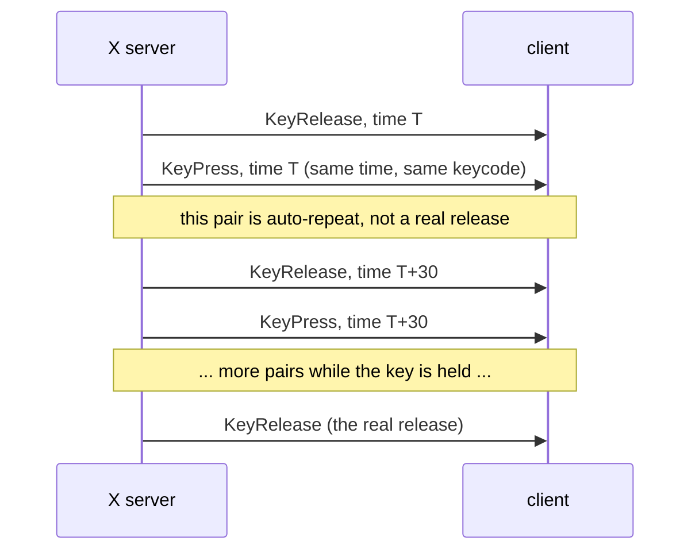

# Chapter 4. Events, keyboard and mouse on X11

**You will learn**

- How the X server delivers pointer, keyboard, focus and resize events
- Why a key press is not a character, and how XKB and xkbcommon bridge the gap
- How to detect key auto-repeat on the core protocol
- How scroll wheels and modifier keys are represented

**Code for this chapter:** `p02_x11_events/main.cpp` (245 lines). It prints every event, so run it next to this text.

---

## 4.1 Events are selected, then delivered

Chapter 3 introduced `XSelectInput`. Here we ask for much more:

```cpp
XSelectInput(dpy, win,
             StructureNotifyMask |
             ExposureMask |
             KeyPressMask | KeyReleaseMask |
             ButtonPressMask | ButtonReleaseMask |
             PointerMotionMask |
             EnterWindowMask | LeaveWindowMask |
             FocusChangeMask);
```

Each mask enables a family of events:

| Mask | Events you receive |
|---|---|
| `StructureNotifyMask` | `ConfigureNotify` (size or position changed), `MapNotify`, `UnmapNotify` |
| `ExposureMask` | `Expose` |
| `KeyPressMask`, `KeyReleaseMask` | `KeyPress`, `KeyRelease` |
| `ButtonPressMask`, `ButtonReleaseMask` | `ButtonPress`, `ButtonRelease` |
| `PointerMotionMask` | `MotionNotify` |
| `EnterWindowMask`, `LeaveWindowMask` | `EnterNotify`, `LeaveNotify` |
| `FocusChangeMask` | `FocusIn`, `FocusOut` |

Run `p02_x11_events` and play with the mouse. Every event prints a line. This is the fastest way to build intuition for what the server actually sends.

## 4.2 The pointer

Pointer events carry coordinates relative to your window (`x`, `y`) and relative to the root (`x_root`, `y_root`), a `state` bitmask with the modifiers and buttons held, and a server `time` in milliseconds.

**Buttons.** Core protocol buttons are numbered:

| Number | Meaning |
|---|---|
| 1 | Left |
| 2 | Middle |
| 3 | Right |
| 4, 5 | Scroll up, scroll down |
| 6, 7 | Scroll left, scroll right |

Scrolling is reported as button presses with numbers 4 to 7. The program only reports a press for those, because the matching release carries no information:

```cpp
if (b >= 4 && b <= 7) { if (down) { ... } }
```

One press equals one wheel notch. High resolution touchpads and smooth scrolling need the XInput2 extension, which this book does not cover (see chapter 13).

**Enter and Leave** tell you when the pointer crosses the window edge. They also fire around grabs, which is why the program prints the `mode` field (`normal`, `grab`, `ungrab`). A drag that leaves the window produces a `grab` leave, and you usually want to ignore those for hover logic.

## 4.3 Focus

`FocusIn` and `FocusOut` tell you whether the window receives keyboard input. A text caret should blink only when focused, and a game should pause when focus is lost. We treat focus as plain state: `bool focused`.

## 4.4 Configure: size and position

`ConfigureNotify` reports the new size and position after the window manager moved or resized you. Treat the event's width and height as the truth. Never assume the size you asked for in `XCreateSimpleWindow` is the size you got. During an interactive resize you will receive a stream of these events, so rebuild your buffers once per batch of events, not once per event (stage 3 does this).

## 4.5 Keys: three layers

A keyboard event involves three different numbers, and confusing them is the number one source of input bugs.



- The **keycode** identifies a physical key position. In X11 it equals the Linux evdev code plus 8 (the kernel's code for the key marked `A` on a US board is 30, X calls it 38). Keycodes do not change with the layout.
- A **keysym** is the symbol that key produces under the current layout and modifiers. The same key gives `XK_a` normally, `XK_A` with Shift, `XK_adiaeresis` on a German layout.
- The **text** is the UTF-8 string to insert into a text field. Some keys give none (arrow keys, F keys, modifiers). Some give a control character (`\x08` for Backspace, `\x0d` for Enter).

Use keycodes for **shortcuts that depend on position** (WASD in a game works on every layout). Use keysyms for **commands** (Ctrl+C should be the key that says C). Use text for **typing**.

### Why not XLookupString?

`XLookupString` and `XLookupKeysym` are the legacy functions. They handle simple layouts but not groups (switching between two layouts) or most modern features, and they rely on a keyboard mapping that Xlib caches. The modern answer is XKB through **libxkbcommon**, which is the same library Wayland compositors and clients use. Learning it once serves both backends.

### Setting up xkbcommon on X11

```cpp
xcb_connection_t* conn = XGetXCBConnection(dpy);
xkb_x11_setup_xkb_extension(conn, XKB_X11_MIN_MAJOR_XKB_VERSION, ...);
xkb_context* ctx = xkb_context_new(XKB_CONTEXT_NO_FLAGS);
int32_t deviceId = xkb_x11_get_core_keyboard_device_id(conn);
xkb_keymap* keymap = xkb_x11_keymap_new_from_device(ctx, conn, deviceId, XKB_KEYMAP_COMPILE_NO_FLAGS);
xkb_state* state = xkb_x11_state_new_from_device(keymap, conn, deviceId);
```

Three objects:

- **Context**: library wide settings. Create one.
- **Keymap**: the complete mapping of keycodes to symbols for a layout. We ask the server for the real one, so we match what the user configured in their desktop settings.
- **State**: the current modifiers and group. This is the mutable object you update.

Xlib and XCB are two separate client libraries for the same protocol. `xkbcommon-x11` is written against XCB, so the program borrows the Xlib connection with `XGetXCBConnection`. Both libraries share the same socket, which is why the link libraries include `x11-xcb`.

### Reading a key

```cpp
const xkb_keysym_t sym = xkb_state_key_get_one_sym(state, keycode);
xkb_state_key_get_utf8(state, keycode, buffer, sizeof buffer);
```

Pass the X keycode directly. xkbcommon uses the same numbering (evdev plus 8).

### Keeping the state in sync

`xkb_state` must learn about every key press and release, or it will not know that Shift is held. There are two strategies:

1. **Feed it key events.** After handling each event call `xkb_state_update_key(state, code, XKB_KEY_DOWN or XKB_KEY_UP)`. Stage 2 does this because it is the simplest thing that works in a demonstration.
2. **Let the server tell you.** XKB can send `XkbStateNotify` events containing the server's current modifier masks, and you call `xkb_state_update_mask` with them. This tracks layout switches, Caps Lock toggled from elsewhere, and keys pressed while another window had focus. The platform layer in chapter 8 uses this approach, and it is the more robust one.

Strategy 2 matters on Wayland, where the compositor sends modifier masks and you must not guess (chapter 7).

## 4.6 Modifiers

`event.state` has bits: `ShiftMask`, `LockMask` (Caps Lock), `ControlMask`, `Mod1Mask` (usually Alt), `Mod4Mask` (usually Super). The program prints them with a helper. For serious work prefer `xkb_state_mod_name_is_active` with names like `XKB_MOD_NAME_CTRL`, because the mod numbers are conventions that a user can remap.

## 4.7 Auto-repeat

Hold a key. The server sends a stream of key events. On the core protocol, auto-repeat looks like this:



A "release" immediately followed by a "press" with the **same timestamp and keycode** is an auto-repeat, not a real release. The program detects this by peeking at the next event:

```cpp
if (XPending(dpy)) {
    XEvent next;
    XPeekEvent(dpy, &next);
    if (next.type == KeyPress && next.xkey.time == ev.xkey.time &&
        next.xkey.keycode == ev.xkey.keycode) {
        XNextEvent(dpy, &next);          // consume it
        // report as repeat
    }
}
```

There is a cleaner option. The XKB extension provides `XkbSetDetectableAutoRepeat(dpy, True, &supported)`, after which the server sends only repeated `KeyPress` events with no fake releases. The platform layer uses that. Stage 2 shows the manual detection so you understand what the server does, and because it works without XKB.

Note that this depends on the server: auto-repeat on X11 is generated by the server, and on Wayland the **client** generates it from a timer (chapter 7). That difference alone breaks many cross platform programs.

## 4.8 Printing control characters

`xkb_state_key_get_utf8` returns control characters for keys such as Enter and Backspace. The program prints them as `\x0d`, `\x08`. Beware this when you build a text field: you must not insert `\x08` into the text. Send commands (Backspace, Delete, arrows) as **key events** and only printable text as **text events**. Our `ww::Event` type has both `KeyEvent` and `TextEvent` for exactly this reason.

## 4.9 The event loop with several sources

Right now the loop calls `XNextEvent`, which blocks on the X connection only. Real programs soon need more: timers (caret blink, animation), file descriptors, wake ups from other threads. The general tool is `poll`:

```cpp
pollfd pfd{ConnectionNumber(dpy), POLLIN, 0};
poll(&pfd, 1, timeoutMs);
```

`ConnectionNumber(dpy)` returns the socket's file descriptor. Add more descriptors to the array for other sources. Chapter 5 uses this to sleep until the next frame or the next event, and chapter 8 builds `waitEvent(out, timeoutMs)` around it.

Careful: Xlib may already have events buffered in memory that `poll` cannot see. Always drain with `XPending` before blocking in `poll`.

## Pitfalls

- **Using keycodes as characters.** `keycode 38` is not `'a'`.
- **Not updating `xkb_state`.** Caps Lock and Shift stop working.
- **Treating auto-repeat as new presses.** A "key pressed" action that fires on each repeat instead of once.
- **Inserting control characters into text fields.** See 4.8.
- **Taking `ConfigureNotify` coordinates as screen positions.** After reparenting, a window's reported `x, y` can be relative to its frame. Use `x_root, y_root` or `XTranslateCoordinates` when position matters.
- **Blocking forever while events sit in Xlib's queue.** Use `XPending`.

## Debugging

- Compare with `xev`. If `xev` shows a key event and your program does not, your event mask is wrong. If both show it but you see the wrong text, your xkb state is wrong.
- `xmodmap -pm` and `setxkbmap -print -verbose 10` show the layout the server is using.
- Switch layouts mid run (Super+Space on many desktops) and confirm the printed text follows.

## Review questions

1. Give an example of a feature that should use keycodes, one that should use keysyms, and one that should use text.
2. What is the relation between an evdev code and an X keycode?
3. How do you recognise auto-repeat on the core protocol? What is the alternative?
4. Why must you keep `xkb_state` updated?
5. Which buttons represent horizontal scroll?

## Exercises

**Ex 4.1** Run `p02_x11_events`, type `Shift+a`, then `a`, then `AltGr+e` (if your layout has it). Explain every line printed for the first two.

**Ex 4.2** Change the keyboard layout (`setxkbmap de`, or via settings) while the program runs. Does the sym output change? Does the program need restarting? Why or why not?

**Ex 4.3** Make the program ignore `LeaveNotify` events whose mode is `grab`. Press and drag outside the window to see why.

**Ex 4.4** Modify the program to call `XkbSetDetectableAutoRepeat` and delete the peek logic. Verify with a held key. (Include `<X11/XKBlib.h>`.)

**Ex 4.5** Write a function `bool isPrintable(const std::string& utf8)` that returns false for control characters, and use it to decide whether to print a `text=` field. Handle multi byte UTF-8 correctly (bytes at or above 0x80 are printable parts of a character).

Solutions: [solutions/ch04.md](solutions/ch04.md)

Previous: [Chapter 3](03-x11-first-window.md) | Next: [Chapter 5, pixels and shared memory](05-x11-pixels-and-shared-memory.md)
