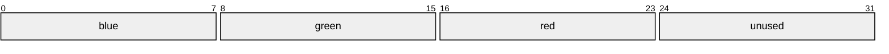
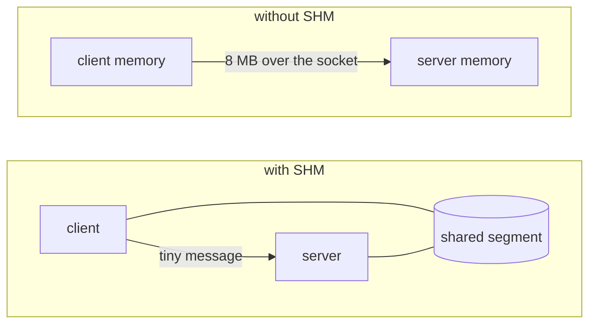

# Chapter 5. Pixels, shared memory and frame pacing on X11

**You will learn**

- What a framebuffer is: pixels, stride, and byte order
- How to get your own pixels onto the screen with `XPutImage`, and why that is slow
- How MIT-SHM shares memory with the server, and the rule you must obey when using it
- How to pace an animation, and how to resize safely

**Code for this chapter:** `p03_x11_pixels/main.cpp` (322 lines). It draws an animated gradient and a square that follows the mouse.

---

## 5.1 From "ask the server to draw" to "draw it yourself"

The X protocol has drawing requests: `XFillRectangle`, `XDrawLine`, `XDrawString`. They are efficient over a slow network and primitive in every other way (no anti-aliasing, no good fonts, no transparency). Modern X programs and all toolkits do something else:

1. Keep a block of memory that holds the window's pixels.
2. Draw into it on the CPU (or with a library such as Cairo).
3. Ask the server to copy the block into the window.

This is called **client side rendering** or software rendering, and it is the model Wayland made mandatory. Learning it on X11 prepares you for both.

## 5.2 What is a framebuffer?

A framebuffer is a rectangle of pixels in memory. For our window we use 32 bits per pixel:



In this diagram bit 0 is on the left, so the word reads `0xXXRRGGBB` from the right: blue in bits 7..0, green in 15..8, red in 23..16, the top byte unused.

In code, a pixel is a `uint32_t` and a colour is `(r << 16) | (g << 8) | b`. The helper in the program is:

```cpp
constexpr uint32_t rgb(unsigned r, unsigned g, unsigned b) { return (r << 16) | (g << 8) | b; }
```

**This layout is not guaranteed.** It is the common case on a 24 or 32 bit TrueColor X server. The program refuses to run if the server disagrees:

```cpp
if (visual->red_mask != 0xff0000 || visual->green_mask != 0x00ff00 ||
    visual->blue_mask != 0x0000ff || depth < 24) { ... exit }
```

A **visual** describes how pixel values map to colours, and the masks say which bits hold each channel. A real library checks and converts. We check and stop, which is honest for a teaching program.

### Stride

Rows in memory may be padded. The distance in bytes between the start of one row and the next is the **stride** (`bytes_per_line` in X). The pixel at `(x, y)` lives at:

```cpp
uint32_t* row = pixels + y * strideInPixels;
row[x] = color;
```

and **not** at `pixels[y * width + x]`. With 32 bit pixels the two usually agree, but writing it correctly now saves a painful bug the first time a server or a library pads rows. Cairo for example requires strides rounded up to multiples of 4 bytes, and Wayland buffers carry their own stride in the protocol. In this book the `ww::Framebuffer` struct always carries a `stride` in bytes.

## 5.3 The slow path: XPutImage

`XPutImage` copies the pixels **through the socket** to the server.

```cpp
XPutImage(dpy, win, gc, image, 0, 0, 0, 0, width, height);
```

For a 1920x1080 window with 4 bytes per pixel, that is about 8 megabytes per frame. At 60 frames per second you would push roughly 500 megabytes per second through a socket, and the server must read it all. It works, and the program uses it as a fallback (for example over a network), but it is not what you want locally.

A **graphics context** (`GC`) accompanies every drawing request. It holds drawing state such as foreground colour and clip region. We create one with `XCreateGC` and mostly ignore its contents, because we are only copying an image.

## 5.4 The fast path: MIT-SHM

The MIT Shared Memory extension lets client and server see **the same physical memory**. Instead of 8 MB over a socket, you send a tiny request: "the pixels are in segment 17, copy them into the window".



It works only when client and server are on the same machine. The program checks `DISPLAY` begins with `:` (a local display) before trying.

### Setting it up

`Framebuffer::createShm` in the program does these steps. Read it alongside this list.

1. `XShmQueryExtension(dpy)` checks the server supports it.
2. `XShmCreateImage` makes an `XImage` that will describe the memory, but allocates no pixels yet.
3. `shmget(IPC_PRIVATE, size, IPC_CREAT | 0600)` asks the kernel for a **System V shared memory segment** big enough for `bytes_per_line * height`.
4. `shmat` maps it into our address space. We point `image->data` at it.
5. `shmctl(id, IPC_RMID, nullptr)` marks the segment for deletion **immediately**. This is a standard trick: the segment continues to exist while anyone is attached, and disappears automatically when the last process detaches, even if we crash. Without this, a crash leaks a segment that survives until reboot (you could find it with `ipcs -m`).
6. `XShmAttach` tells the server to map the same segment.

The attach request is asynchronous. If it fails (wrong permissions, a server in a container that cannot see our segment), the error arrives later as an X error, and the default handler would call `exit`. The program installs its own handler, calls `XSync` to force the error out, and then falls back to the plain path if one arrived:

```cpp
auto* old = XSetErrorHandler(onXError);
XShmAttach(dpy_, &shm_);
XSync(dpy_, False);
XSetErrorHandler(old);
if (g_x11ErrorSeen) { ... fall back ... }
```

This pattern, "try, sync, inspect", is how you probe for optional capabilities in X.

### Sending a frame

```cpp
XShmPutImage(dpy, win, gc, image, 0, 0, 0, 0, w, h, /*send_event=*/True);
XFlush(dpy);
```

`send_event = True` asks the server to send an `ShmCompletion` event when it is done reading our memory. That brings us to the one rule you must remember.

## 5.5 The rule: do not touch the buffer while the server reads it

`XShmPutImage` returns immediately. The server reads your memory **later**. If you overwrite the buffer in between, the server may copy a half old, half new image. That is visible tearing, and it is a data race between two processes.

The program tracks this with a flag:

```cpp
bool inFlight = false;

// after presenting
inFlight = fb->present(win, gc);

// in the event loop
if (ev.type == shmEventBase + ShmCompletion) { inFlight = false; continue; }

// before drawing
if (now >= nextFrame && !inFlight) { drawFrame(...); ... }
```

Event types of extensions are numbered relative to a base that the server hands out, so you compute `XShmGetEventBase(dpy) + ShmCompletion`. You cannot use a `case` label for it.

With one buffer the program must wait for completion before it draws the next frame. That is simple and correct. The upgrade is **double buffering**: keep two framebuffers, draw into one while the server reads the other, and swap. Wayland forces this on you (chapter 6 uses up to three buffers), and the Wayland section there shows how the same idea looks with a release event.

## 5.6 Resizing safely

When the user resizes the window, the framebuffer must change size. But the buffer may be in flight. The program stores the new size and applies it only when safe:

```cpp
case ConfigureNotify:
    if (w != width || h != height) { pendingW = ...; pendingH = ...; }

// later in the loop
if (pendingW > 0 && !inFlight) {
    delete fb;
    fb = new Framebuffer(dpy, visual, depth, pendingW, pendingH, localDisplay);
}
```

Applying it once per loop iteration also means a burst of `ConfigureNotify` events during a drag costs one allocation, not dozens.

Destruction order matters too. `~Framebuffer` for a SHM image does:

```cpp
XShmDetach(dpy_, &shm_);
XSync(dpy_, False);     // the server really has let go
XDestroyImage(image_);  // frees the struct, not the data
shmdt(shm_.shmaddr);
```

Skipping the `XSync` risks unmapping memory the server still has mapped, which is the kind of bug that appears once in a hundred runs.

## 5.7 Preventing flicker

A resized window exposes new area. By default the server clears exposed areas to the window's background before telling you to repaint, producing a flash. Since we repaint every pixel, we tell the server not to bother:

```cpp
XSetWindowBackgroundPixmap(dpy, win, None);
```

## 5.8 Frame pacing and the loop

The loop has four steps. Read them in the source, in this order:

1. **Drain events.** `while (XPending(dpy)) { XNextEvent... }`, updating variables only.
2. **Apply a pending resize** if no frame is in flight.
3. **Draw if due** (about every 16.667 ms) and not in flight.
4. **Sleep** in `poll` until the next frame is due or the X socket has data.

```cpp
pollfd pfd{ConnectionNumber(dpy), POLLIN, 0};
const int timeoutMs = inFlight ? 5 : std::max(int(wait.count()), 0);
poll(&pfd, 1, timeoutMs);
```

This animation redraws continuously, so it has no idle state. That is intentional for the demo. The UI toolkit in chapter 10 draws only on demand, and sleeps with `timeout = -1` when nothing is pending.

Note the schedule update `nextFrame = std::max(nextFrame + frameTime, now)`. Adding the frame time keeps the average rate steady even if one frame ran late. The `max` stops the program from trying to "catch up" with a burst of back to back frames after a long stall.

**Why not `usleep(16000)`?** It would delay reaction to input by up to a frame, burn latency on every event, and drift. `poll` with a timeout lets input interrupt the sleep.

This timer is only a guess at the display refresh. X11 has no good way to know when the monitor actually refreshes (the Present extension helps, and compositors add their own synchronisation). Wayland gives you a proper signal, the frame callback, and that is one of the clearest improvements it makes.

## 5.9 Drawing code

`drawFrame` fills every pixel from its coordinates and the time, then draws two rectangles. The helper that clips is worth reading:

```cpp
void fillRect(Framebuffer& fb, int x, int y, int w, int h, uint32_t color) {
    const int x0 = std::max(x, 0), y0 = std::max(y, 0);
    const int x1 = std::min(x + w, fb.width()), y1 = std::min(y + h, fb.height());
    for (int yy = y0; yy < y1; ++yy) {
        uint32_t* row = fb.pixels() + size_t(yy) * fb.stride();
        std::fill(row + x0, row + x1, color);
    }
}
```

Clipping to the buffer bounds is not decoration. A rectangle that extends past the edge would otherwise write into the next row, or beyond the allocation. This is the single most common crash in hand written rasterisers, and it is why we will move to Cairo in chapter 9.

## Pitfalls

- **Writing outside the buffer.** Clip every drawing operation.
- **Assuming stride equals width times 4.**
- **Reusing the buffer before `ShmCompletion`.**
- **Using SHM on a remote display.** It fails, and the failure is asynchronous.
- **Leaked SHM segments.** Check with `ipcs -m`. The `IPC_RMID` trick prevents it.
- **Forgetting the visual check.** On unusual servers (16 bit depth, BGR order) colours come out wrong, not blank, which is hard to diagnose.
- **Redrawing at 60 fps forever** in an application that is mostly static.

## Review questions

1. What is the stride of a 640 pixel wide, 4 byte per pixel image if rows are padded to 64 bytes?
2. Why call `shmctl(IPC_RMID)` right after attaching?
3. What would you observe if you ignored `ShmCompletion` and drew every frame regardless?
4. Why is the SHM attach checked with an error handler and `XSync`?
5. What is the difference between "damage" (which part changed) and "frame pacing" (when to draw)?

## Exercises

**Ex 5.1** Run the program and print the transfer method. Then run it with `DISPLAY` set to a remote or SHM-less setup (for instance `ssh -X` into another machine) and observe the fallback.

**Ex 5.2** Draw a checkerboard instead of the gradient, using the stride correctly. Make the squares 32 pixels.

**Ex 5.3** Implement **double buffering**: keep two `Framebuffer`s. Draw into the free one, present it, and track which is in flight by `ShmCompletion`. Measure CPU use and smoothness before and after.

**Ex 5.4** Add an FPS counter to the terminal (once per second). What rate do you get? Does it match 60? What limits it?

**Ex 5.5** Change the program so it only redraws when the mouse moves or the window changes. Verify with `top` that it uses almost no CPU when you leave it alone.

**Ex 5.6** Write `drawLine(fb, x0, y0, x1, y1, color)` with Bresenham's algorithm, clipped properly. Draw a line from the corner to the mouse.

Solutions: [solutions/ch05.md](solutions/ch05.md)

Previous: [Chapter 4](04-x11-events-and-keyboard.md) | Next: [Chapter 6, Wayland basics](06-wayland-first-window.md)
