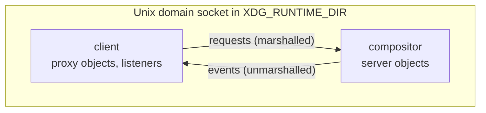
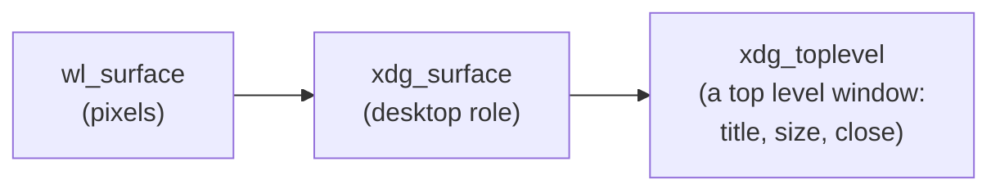
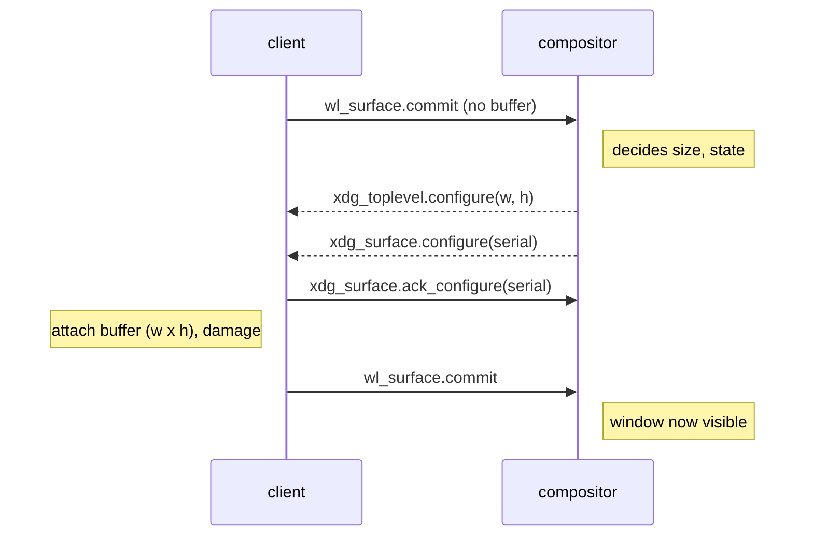

# Chapter 6. Your first Wayland window

**You will learn**

- How the Wayland protocol is organised: objects, requests, events and the registry
- How `wayland-scanner` turns XML into the C functions you call
- How to create shared memory buffers with `memfd_create`
- The `xdg-shell` handshake that turns a surface into a window, and why the first commit has no buffer
- How buffer ownership works, and when a buffer can be destroyed

**Code for this chapter:** `p04_wayland_window/main.cpp` (198 lines).

---

## 6.1 The shape of the protocol

Wayland is a protocol between a **client** and a **compositor**, carried over a Unix socket. Its building blocks:

- **Objects.** Everything is an object with a numeric id on the connection: the registry, a surface, a buffer, a keyboard. The client holds a *proxy* (a C struct pointer such as `wl_surface*`) for each.
- **Requests.** Calls from client to compositor, for example `wl_surface_commit(surface)`.
- **Events.** Messages from compositor to client, for example "the keyboard focus entered this surface". You receive them by registering a **listener**, a struct of function pointers.
- **Interfaces and versions.** Each object type is an *interface* (`wl_surface`) with a version number. New requests and events are added in newer versions. A client binds each global at the version it understands, never above what the compositor offers.

Everything is **asynchronous**. Requests are queued and written to the socket. Events arrive later, and your listeners run when you dispatch.



## 6.2 Where the C functions come from

The protocol is described in XML. For example, in `protocols/xdg-shell.xml` you find:

```xml
<interface name="xdg_wm_base" version="5">
  <request name="get_xdg_surface"> ... </request>
  <event name="ping"> <arg name="serial" type="uint"/> </event>
</interface>
```

`wayland-scanner` produces two files (chapter 2):

- A **header** (`xdg-shell-client-protocol.h`) with `xdg_wm_base_get_xdg_surface(...)`, the listener struct `xdg_wm_base_listener { void (*ping)(...); }`, and `xdg_wm_base_add_listener`.
- A **C file** with tables that describe each message's signature, so libwayland can marshal arguments into bytes.

That is the whole trick. Request functions are thin wrappers around `wl_proxy_marshal`. There is nothing magical to debug, and `WAYLAND_DEBUG=1` shows each message in text.

## 6.3 The registry: discovering what exists

A compositor does not give you a fixed set of features. It publishes **globals**: named objects that clients may bind. You find them through the registry.

```cpp
app.registry = wl_display_get_registry(app.display);
wl_registry_add_listener(app.registry, &kRegistryListener, &app);
wl_display_roundtrip(app.display);
```

`wl_display_roundtrip` sends everything queued, waits until the compositor has answered, and dispatches events. After it returns, the `global` callback has run once per advertised global. In the callback you bind what you need:

```cpp
if (std::strcmp(interface, wl_compositor_interface.name) == 0) {
    app->compositor = static_cast<wl_compositor*>(
        wl_registry_bind(registry, name, &wl_compositor_interface, std::min(version, 4u)));
}
```

Notes:

- `name` is a numeric id for the global, `interface` is its string name, `version` is the highest version offered.
- We bind at `min(version, N)` where N is the version this code was written for. Never bind higher than you understand.
- Three globals are mandatory here: `wl_compositor` (creates surfaces), `wl_shm` (shared memory), `xdg_wm_base` (desktop windows). The program checks that all three arrived.

Run `wayland-info` (package `wayland-utils`) to see the real list on your machine. You will see things like `wl_seat`, `wl_output`, `zxdg_decoration_manager_v1`, and many more.

## 6.4 Surfaces are only pixels

A `wl_surface` is a rectangle of pixels with no meaning. It is not a window. It could be a cursor image, a drag icon, or a subsurface. To become a window it needs a **role**, and for desktop windows the role comes from the `xdg-shell` protocol:



```cpp
app.surface    = wl_compositor_create_surface(app.compositor);
app.xdgSurface = xdg_wm_base_get_xdg_surface(app.wmBase, app.surface);
app.toplevel   = xdg_surface_get_toplevel(app.xdgSurface);
xdg_toplevel_set_title(app.toplevel, "Stage 4: Wayland window");
xdg_toplevel_set_app_id(app.toplevel, "linux-windowing.p04");
xdg_toplevel_set_min_size(app.toplevel, 200, 120);
```

The **app id** is how the desktop matches your window to a `.desktop` file for its icon and name. A popup menu would use `xdg_popup` instead of `xdg_toplevel`.

## 6.5 The configure handshake

Here is the idea that surprises X11 programmers. **You do not decide when your window may be drawn, and you do not decide its size. The compositor tells you.**

The sequence:



Code, in order:

```cpp
wl_surface_commit(app.surface);            // 1. initial commit, NO buffer
...
void onToplevelConfigure(..., int32_t w, int32_t h, ...) {   // 2. size suggestion
    app->pendingWidth = w; app->pendingHeight = h;
}
void onXdgSurfaceConfigure(..., uint32_t serial) {           // 3. "state is complete"
    xdg_surface_ack_configure(surf, serial);
    // adopt pending size, then draw
    draw(*app);                                              // 4. commit a buffer
}
```

Key facts:

- **The first commit must not attach a buffer.** It tells the compositor "my window is set up, please configure me". Attaching a buffer before the first configure is a protocol error and the compositor disconnects you.
- `xdg_toplevel.configure` carries the suggested size and states (maximised, fullscreen, activated). A size of `0 x 0` means "you choose".
- `xdg_surface.configure` arrives after the toplevel events and **ends** a set of changes. Acknowledge it with the same serial before you commit.
- The compositor expects a buffer whose size fits the window. If you cannot (minimum size), you may pick another size and the compositor adapts.

This handshake is why Wayland windows do not flicker or show garbage during resizes: the size and the buffer change together.

### Ping

`xdg_wm_base.ping(serial)` asks "are you alive?". Reply with `pong` with the same serial. A program that never replies is marked "not responding" and the desktop offers to kill it. Our listener is one line, but it only works if your event loop keeps dispatching, so never block for long in a handler.

### Close

```cpp
void onToplevelClose(void* userData, xdg_toplevel*) { app->running = false; }
```

This is the Wayland counterpart of `WM_DELETE_WINDOW`: a request, not a kill.

## 6.6 Shared memory buffers

To show pixels you give the compositor a buffer. With `wl_shm` the buffer lives in memory that both processes map. The steps in `createShmBuffer`:

1. **Create a file descriptor for anonymous memory.** `memfd_create("name", MFD_CLOEXEC)` returns an fd that refers to a memory only file, no file system entry, destroyed when closed everywhere. (Older code used a temp file in `$XDG_RUNTIME_DIR`. `memfd_create` is simpler.)
2. **Size it.** `ftruncate(fd, size)`.
3. **Map it.** `mmap(..., PROT_READ | PROT_WRITE, MAP_SHARED, fd, 0)` gives you a pointer to write pixels through.
4. **Create a pool.** `wl_shm_create_pool(shm, fd, size)`. The fd is sent to the compositor over the socket using Unix ancillary data (`SCM_RIGHTS`), so it gets its own handle on the same memory.
5. **Create a buffer inside the pool.** `wl_shm_pool_create_buffer(pool, offset, width, height, stride, format)`.
6. **Destroy the pool and close the fd.** The buffer holds the memory alive.

```cpp
wl_buffer* buf = wl_shm_pool_create_buffer(pool, 0, width, height, stride, WL_SHM_FORMAT_XRGB8888);
wl_shm_pool_destroy(pool);
close(fd);
```

A pool may hold many buffers at different offsets. That is the efficient pattern for double or triple buffering. Stage 4 uses one pool per buffer to keep the code short.

**Formats.** `WL_SHM_FORMAT_XRGB8888` means 32 bit pixels, the top byte ignored, with R, G, B in the next bytes, as a *little endian 32 bit word*. In memory on x86 that is bytes `B G R X`. Write it as `uint32_t` values `0xXXRRGGBB`, the same layout we used on X11. `ARGB8888` adds alpha, with **premultiplied** colour. Every compositor must support these two formats, which is why we never negotiate.

**Stride** is explicit in the call, as on X11. We use `width * 4`.

### Attach, damage, commit

```cpp
wl_surface_attach(app.surface, b->buffer, 0, 0);
wl_surface_damage_buffer(app.surface, 0, 0, app.width, app.height);
wl_surface_commit(app.surface);
```

- **Attach** says "this is the next buffer". The offsets are obsolete, pass zero.
- **Damage** says which part changed, so the compositor can skip work. We say "all of it". `damage_buffer` uses buffer coordinates (pixels). The older `damage` uses surface coordinates and is confusing with HiDPI, so prefer `damage_buffer`.
- **Commit** makes the pending state active **atomically**. Everything you attached or changed since the last commit takes effect together. This is the core of the "every frame is perfect" guarantee.

## 6.7 Who owns the buffer? The release event

After commit, the compositor may keep reading your buffer for as long as it likes, for example to composite it on every output frame while the content does not change. It sends `wl_buffer.release` when it no longer needs it. Until then **you must not modify or destroy the buffer's memory.** (This is the Wayland equivalent of X11's `ShmCompletion`.)

Stage 4 uses the simplest correct strategy for static content, the **one shot buffer**:

```cpp
void onBufferRelease(void* userData, wl_buffer*) {
    auto* b = static_cast<ShmBuffer*>(userData);
    wl_buffer_destroy(b->buffer);
    munmap(b->data, b->size);
    delete b;
}
```

Each frame allocates a new buffer. When the compositor releases it, we free it. Cheap enough for a window that changes only when resized, unacceptable for an animation. Chapter 7 shows a pool of reused buffers (up to three) with release tracking, which is what the platform layer uses.

One thing to know: some compositors release a buffer as soon as it has been copied, others hold it while the next frame is shown. Never assume. Always wait for `release`.

## 6.8 Dispatching

```cpp
while (app.running && wl_display_dispatch(app.display) != -1) { }
```

`wl_display_dispatch` blocks until events arrive, reads them from the socket, and calls the right listeners. This is the Wayland equivalent of `XNextEvent`, and in this stage it is the entire main loop. Everything happens inside listeners.

For programs that also wait on timers or other file descriptors, you cannot use this blocking call. Chapter 7 shows the multi source pattern with `wl_display_prepare_read`, `poll`, `wl_display_read_events` and `wl_display_dispatch_pending`, and why that dance exists.

## 6.9 Clean up

Destroy objects in reverse order of creation: toplevel, xdg surface, surface, then the globals, then disconnect. Leaving them to process exit works but hides ownership mistakes from sanitizers.

## 6.10 Run it, and read the conversation

```
./build/gcc-debug/p04_wayland_window/p04_wayland_window
WAYLAND_DEBUG=1 ./build/gcc-debug/p04_wayland_window/p04_wayland_window 2>&1 | head -60
```

In the second form every message prints, with arrows showing direction (`->` is a request from you, no arrow prefix means an event). You can follow `get_registry`, the `global` events, `bind`, `create_surface`, `get_xdg_surface`, `get_toplevel`, the first `commit`, the two configure events, the `ack_configure`, the `create_pool`, `attach`, `damage_buffer`, `commit`.

Reading this transcript once makes the protocol concrete in a way no description can.

On GNOME the window has no title bar. GNOME does not provide server side decorations, and this stage does not draw its own. The window is movable only through keyboard shortcuts. On KDE or Sway you get decorations from the compositor. Chapter 7 fixes the GNOME case.

## Pitfalls

- **Attaching a buffer before the first configure.** Protocol error, and the connection is dropped.
- **Forgetting `ack_configure`.** The compositor ignores the next commit or complains.
- **Destroying or rewriting a buffer before `release`.** Flicker, garbage, or a crash.
- **Writing outside the mapped region.** Same bounds problem as X11. Also, never shrink the underlying file after sharing it: a compositor reading past the end would take a `SIGBUS`. Compositors guard against this and disconnect you with an error.
- **Binding a higher version than you understand.**
- **Blocking in a listener** (waiting on I/O, long computation). The compositor will ping you and mark you unresponsive.
- **Expecting a window position.** Wayland clients cannot place or query their own absolute position. That is by design.

## Review questions

1. What is the difference between a `wl_surface` and an `xdg_toplevel`?
2. Why is the first commit made without a buffer?
3. What does the registry tell you that X11's `XOpenDisplay` did not?
4. When may you reuse or free a `wl_buffer`'s memory?
5. What guarantee does commit give?
6. Why does a Wayland client not know where its window is on the screen?

## Exercises

**Ex 6.1** Run with `WAYLAND_DEBUG=1`. Find the line where your app binds `xdg_wm_base`, the first `configure`, and the first `commit` that carries a buffer. Write down the order of the three.

**Ex 6.2** Print every global the registry announces (name, interface, version). Compare with `wayland-info`.

**Ex 6.3** Draw a gradient instead of a solid colour. Respect the stride.

**Ex 6.4** Print the width and height from `onToplevelConfigure` and resize the window. When is it `0 x 0`? When is it not?

**Ex 6.5** Modify the program to request `xdg_toplevel_set_maximized` after creating the toplevel, and look at the states array in the configure callback. Which state is reported?

**Ex 6.6** Break the rules on purpose: attach a buffer before the first configure. Describe what the compositor does. (Use a throw away copy of the code.)

Solutions: [solutions/ch06.md](solutions/ch06.md)

Previous: [Chapter 5](05-x11-pixels-and-shared-memory.md) | Next: [Chapter 7, Wayland input, decorations and scaling](07-wayland-input-and-decorations.md)
