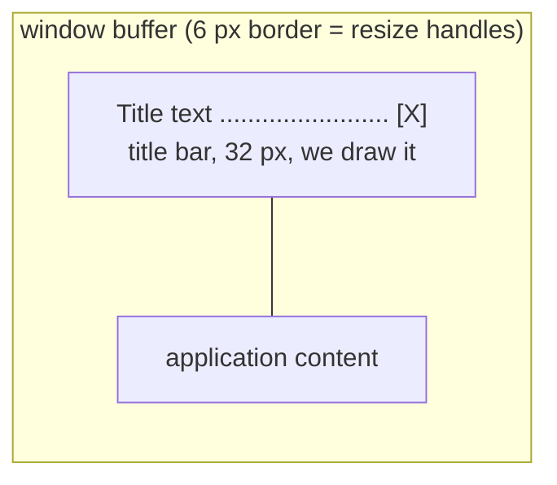

# Chapter 7. Wayland input, frame pacing, decorations and HiDPI

**You will learn**

- How `wl_seat` delivers pointer and keyboard objects
- Why the keymap arrives as a file descriptor, and why key repeat is your job
- How to integrate the Wayland socket into a `poll` loop correctly
- How frame callbacks pace drawing, and how a buffer pool with release tracking works
- How decorations work: asking for server side, drawing client side, and delegating move and resize to the compositor
- How integer HiDPI scaling works

**Code for this chapter:** `p05_wayland_input/main.cpp` (782 lines, the biggest standalone stage). The library backend `lib/platform/src/wayland_window.cpp` contains a cleaner version of the same ideas, and chapter 8 reads it again.

---

## 7.1 Everything X11 gave you for free

Compare with stages 2 and 3. On X11 the server did this for you:

| Feature | X11 | Wayland |
|---|---|---|
| Keyboard layout and text | Ask the server for the keymap | Compositor sends the keymap as a file |
| Key auto-repeat | Server generates it | **Client** generates it from a timer |
| Cursor image | Server draws it | **Client** supplies the image |
| Title bar | Window manager | Compositor, or **client** (GNOME) |
| Draw timing | Guess with a timer | Compositor says when (frame callback) |
| Window move and resize | WM does it | Client asks, compositor runs the drag |

Stage 5 implements all of these. This is why Wayland programs need a toolkit or a layer like ours.

## 7.2 Input starts at the seat

A **seat** (`wl_seat`) is a group of input devices used together by one user: a keyboard, a mouse, maybe a touch screen. It announces its **capabilities** as a bit mask, and you create device objects for the ones you want.

```cpp
void onSeatCapabilities(void* userData, wl_seat* seat, uint32_t caps) {
    if ((caps & WL_SEAT_CAPABILITY_POINTER) && !app->pointer) {
        app->pointer = wl_seat_get_pointer(seat);
        wl_pointer_add_listener(app->pointer, &kPointerListener, app);
    }
    if ((caps & WL_SEAT_CAPABILITY_KEYBOARD) && !app->keyboard) { ... }
    // and release them when a capability disappears (unplugged keyboard)
}
```

Capabilities can change at run time, so create and destroy devices accordingly.

## 7.3 The keyboard

### The keymap as a file descriptor

When the keyboard is created, the compositor sends `wl_keyboard.keymap(format, fd, size)`. The keymap is a text description in XKB format, passed as a file descriptor to avoid copying a large string over the socket. You map it, compile it with xkbcommon, and discard the mapping:

```cpp
void* map = mmap(nullptr, size, PROT_READ, MAP_PRIVATE, fd, 0);
close(fd);
xkb_keymap* keymap = xkb_keymap_new_from_buffer(ctx, (const char*)map, strnlen(map, size),
                                               XKB_KEYMAP_FORMAT_TEXT_V1, XKB_KEYMAP_COMPILE_NO_FLAGS);
munmap(map, size);
xkb_state* state = xkb_state_new(keymap);
```

Note `MAP_PRIVATE` (we only read it) and that the keymap string is NUL terminated inside the mapping, hence `strnlen`. The keymap can arrive again if the user changes layout, so replace the old objects when it does.

### Key events carry evdev codes

`wl_keyboard.key(serial, time, key, state)` gives the raw evdev code. xkbcommon wants the X numbering, so add 8:

```cpp
const xkb_keycode_t code = key + 8;
```

Everything from chapter 4 then applies: keycode to keysym to text.

### Modifiers come from the compositor

Here is the difference from X11 stage 2. On Wayland you must **not** call `xkb_state_update_key`. The compositor sends `wl_keyboard.modifiers(depressed, latched, locked, group)` whenever the modifier state changes, and you feed exactly that:

```cpp
xkb_state_update_mask(state, depressed, latched, locked, 0, 0, group);
```

The compositor is authoritative: it knows about layout switch shortcuts, sticky keys and keys pressed while another window had focus. If you also updated by key events you would double count.

### Key repeat is the client's job

The compositor sends only `wl_keyboard.repeat_info(rate, delay)`: "repeat at this many keys per second after this many milliseconds". Nothing repeats unless you generate it. Stage 5 uses a Linux **timerfd**, a file descriptor that becomes readable when a timer fires:

```cpp
timerfd_create(CLOCK_MONOTONIC, TFD_CLOEXEC | TFD_NONBLOCK);

itimerspec spec{};
spec.it_value    = initial delay;
spec.it_interval = 1 second / rate;
timerfd_settime(fd, 0, &spec, nullptr);
```

On press of a key that repeats (`xkb_keymap_key_repeats` tells you, because Shift and Ctrl should not), arm the timer. On release of that key, disarm it. On focus loss, disarm it, or you get a key that repeats forever. When the timer fd is readable, `read` it to learn how many expirations happened and emit that many repeat events. The program caps this at four so that a stalled loop does not flood the application with hundreds of characters.

This is exactly what a GUI toolkit does for you on Wayland. Now you know why typing in some very early Wayland programs ignored holding keys.

## 7.4 The pointer

Pointer events arrive as `enter`, `leave`, `motion`, `button`, `axis` (scroll) and `frame`.

- Coordinates are `wl_fixed_t`, a signed 24.8 fixed point value. Convert with `wl_fixed_to_double`. They are in **surface local** coordinates (logical pixels).
- `button` carries the Linux evdev code (`BTN_LEFT`, `BTN_RIGHT`, from `<linux/input-event-codes.h>`), unlike X11's 1, 2, 3.
- `axis` is scroll, in a continuous unit. Newer versions add discrete steps and `value120` (120 per wheel notch) so you can tell a wheel from a touchpad. The demo uses the simple event.
- The `frame` event groups the events that belong together (for example a diagonal scroll has both axes). A careful client batches until `frame`. The demo ignores it, and chapter 8's backend pushes events immediately.
- **Serials.** Many requests need the serial of the input event that triggered them (`enter`, `button`, `key`). The compositor uses it to check that the request really follows user input. That is how drags, window menus and clipboard ownership are authorised.

### Cursor image

The compositor does not draw a cursor for you. You must:

1. Load a cursor theme: `wl_cursor_theme_load(nullptr, size, shm)`.
2. Create a separate `wl_surface` just for the cursor image.
3. On `wl_pointer.enter`, call `wl_pointer_set_cursor(pointer, serial, cursorSurface, hotspotX, hotspotY)` with the **serial of the enter event**.
4. Pick the image by name: `"left_ptr"`, `"text"` (the I-beam), `"pointer"` (the hand). Names follow the cursor spec, and the library falls back where a theme lacks one.

The cursor must be reapplied on every `enter`, and on every cursor change you want, and it needs scaling for HiDPI (section 7.8).

## 7.5 A correct event loop with the Wayland socket

Stage 4 used `wl_display_dispatch`, which blocks. Now we need to wait on two things, the socket and the repeat timer. libwayland has a specific dance for this, and getting it wrong causes lost events and hangs:

```cpp
while (running) {
    // 1. Tell libwayland we intend to read. Fails if events are already queued.
    while (wl_display_prepare_read(display) != 0)
        wl_display_dispatch_pending(display);       // handle queued events first

    // 2. Send everything we have queued.
    wl_display_flush(display);

    // 3. Wait for either source.
    pollfd fds[2] = {{wl_display_get_fd(display), POLLIN, 0}, {repeatTimer, POLLIN, 0}};
    poll(fds, 2, timeoutMs);

    // 4. Either read the socket, or cancel the read intention.
    if (fds[0].revents & POLLIN) wl_display_read_events(display);
    else                         wl_display_cancel_read(display);

    // 5. Run the listeners for what arrived.
    wl_display_dispatch_pending(display);

    // 6. Handle the timer.
}
```

Why so elaborate? `prepare_read` and `read_events` make socket reading safe even if several threads exist, and they guarantee you never block in `poll` with events already sitting in libwayland's internal queue (which `poll` cannot see, the same trap as `XPending` on X11). Every `prepare_read` must be followed by exactly one `read_events` or `cancel_read`.

Also flush before sleeping. `flush` can fail with `EAGAIN` if the socket buffer is full. A thorough client then also polls for `POLLOUT`. Our demo tolerates that case.

## 7.6 Frame callbacks: drawing at the right moment

On X11 we guessed a 60 Hz timer. On Wayland the compositor tells us.

```cpp
wl_callback* cb = wl_surface_frame(surface);
wl_callback_add_listener(cb, &listener, app);
wl_surface_attach(...); wl_surface_damage_buffer(...);
wl_surface_commit(surface);          // the frame request takes effect with this commit
```

`wl_surface.frame` asks: "tell me when it is a good time to draw the next frame". The callback fires once, after the compositor has presented the committed content (or is ready for another one). In it you draw and request the next callback:

```cpp
void onFrameDone(void* ud, wl_callback* cb, uint32_t timeMs) {
    wl_callback_destroy(cb);
    app->frameCallback = nullptr;
    render(*app, /*requestNextFrame=*/true);
}
```

The consequences are what you want:

- Rendering is tied to the monitor refresh rate, with no tearing and no wasted frames.
- If your window is minimised or on another workspace, the compositor stops calling back and your animation stops. **Zero CPU for hidden windows**, free.
- A static application requests no callback at all. It only commits when something changes, and in that case you do not use the callback loop.

Rule of thumb: ask for a frame callback on each commit when animating, and just commit directly when responding to input.

## 7.7 A buffer pool with release tracking

Chapter 6 destroyed each buffer at release. For repeated drawing you reuse buffers. Stage 5 keeps a small list:

```cpp
struct Buffer {
    wl_buffer* buffer; uint32_t* data; int width, height;
    bool busy = false;       // from commit until release
    bool obsolete = false;   // wrong size now: destroy when released
};
```

`acquireBuffer(width, height)` returns a **non busy buffer of the right size**, or creates one. After committing set `busy = true`. In `onBufferRelease`, set `busy = false`, and if the buffer is `obsolete` (the window was resized meanwhile) destroy it. The library backend caps the pool at three buffers (`kMaxBuffers`): one the compositor displays, one it is queued to display, and one to draw into. If the compositor is slow, the cap stops memory growth.

Why more than two? With two buffers, at the moment you finish drawing buffer B, the compositor may still own A (displaying) and not yet have released it, while B is the only free one. Three removes the stall in common cases without large memory use.

## 7.8 Decorations

On a Wayland desktop, who draws the title bar? Ask the compositor.

### Server side decorations

The `xdg-decoration` protocol lets you request a mode:

```cpp
auto* dec = zxdg_decoration_manager_v1_get_toplevel_decoration(manager, toplevel);
zxdg_toplevel_decoration_v1_add_listener(dec, &listener, app);
zxdg_toplevel_decoration_v1_set_mode(dec, ZXDG_TOPLEVEL_DECORATION_V1_MODE_SERVER_SIDE);
```

The compositor answers with `configure(mode)`. KDE, Sway, wlroots compositors say server side. **GNOME (Mutter) does not implement the protocol at all**, so `manager` is null on GNOME and you are on your own. Treat it as a request, never a guarantee: the program sets `clientSideDecorations = (mode != SERVER_SIDE)` in the answer.

### Client side decorations

If we must draw, we draw a title bar and a border inside our own buffer. The window buffer is a bit larger than the content, and the content is drawn offset below the bar:



We also need **hit testing**: given the pointer position, which region is it in (title bar, close button, one of eight resize edges and corners, or content)? The `Region` enum and `hitTest` do that, and the result decides what a click means.

### Do not implement the drag yourself

For moving and resizing, the client must not track the mouse and reposition. A Wayland client cannot place its own window. Instead it hands the drag to the compositor:

```cpp
xdg_toplevel_move(toplevel, seat, serial);            // user pressed on the title bar
xdg_toplevel_resize(toplevel, seat, serial, edge);    // user pressed on a border
xdg_toplevel_show_window_menu(toplevel, seat, serial, x, y);   // right click
xdg_toplevel_set_maximized / unset_maximized / set_minimized
```

The `serial` is the one from the button press event. The compositor checks that a real press happened, then runs the interactive drag itself, with its own animations, snapping and tiling, and sends `configure` events as the size changes. This is a great design: the compositor owns layout.

Double click on the title bar toggles maximise. The demo measures 400 ms between presses using the event `time` field (milliseconds, from the compositor).

## 7.9 HiDPI with integer scale

A 4K monitor at 200 percent has twice as many pixels per logical unit. Wayland handles this with a buffer scale.

- Your surface has a **logical size** (say 800 x 600). That is what configure events and pointer coordinates use.
- With scale 2 you provide a buffer of 1600 x 1200 **and tell the compositor**: `wl_surface_set_buffer_scale(surface, 2)`. It then treats each buffer pixel as half a logical unit and displays the surface at 800 x 600 logical size.
- The compositor tells you which scale you need through the `wl_output.scale` event (and `wl_surface.enter/leave` tells you which output the window is on, so you can pick the highest scale among outputs it touches). Newer compositors add `wl_surface.preferred_buffer_scale`.

In the platform layer this is `updateScale()`, which computes `scale_`, allocates buffers of `logical * scale_` pixels, calls `set_buffer_scale`, and tells Cairo with `cairo_surface_set_device_scale(surface, scale, scale)` so drawing code keeps using logical coordinates. Cursor themes need `24 * scale` pixel images too.

Why integer scale only? It is simple and always supported. For 125 percent or 150 percent, a compositor renders at the next integer and scales down, which blurs. The proper answer is the `wp-fractional-scale` and `wp-viewporter` protocols, listed in chapter 13.

You can test without a HiDPI monitor: `WW_SCALE=2` forces the scale in the platform layer.

## 7.10 Putting it together: the checklist for a real Wayland client

1. Connect, get registry, roundtrip, bind globals.
2. Roundtrip again so seat capabilities and the keymap arrive before the first draw.
3. Create surface, xdg surface, toplevel, set title and app id.
4. Request decorations if the manager exists.
5. Commit with no buffer. Wait for configure.
6. Ack, draw, commit.
7. Run the `prepare_read` loop with timers and sockets.
8. On every commit, track buffer busy state and the frame callback.
9. Clean up in reverse order.

## Pitfalls

- **Updating xkb state from key events** on Wayland. Use the modifiers event.
- **Forgetting to cancel repeat on focus loss.** Phantom repeating keys.
- **A `poll` loop without `prepare_read`.** Events stuck in the queue, the program looks hung until the next socket activity.
- **Not replying to `ping`** while busy.
- **Using stale serials.** Requests that need a serial must use the latest one from the right event type.
- **Drawing without a frame callback while animating.** You spam commits faster than the display and waste power.
- **Assuming the cursor persists.** It resets on every enter. Set it again.
- **Mixing logical and buffer coordinates.** Pointer events and sizes are logical, buffers are logical times scale. `damage_buffer` takes buffer pixels.
- **Assuming decorations exist.** On GNOME a window with no decorations of its own has no way to be moved with the mouse.

## Debugging

- `WAYLAND_DEBUG=1` shows `wl_keyboard.key`, `modifiers`, `frame` callbacks and `release` events with timestamps. Look for a buffer that is committed twice without a release in between.
- `wayland-info` shows which of `zxdg_decoration_manager_v1` and the scale protocols your compositor offers.
- Test under more than one compositor. GNOME, KDE and Sway differ in decorations, scaling and key repeat settings, and software that only ever ran on one regularly breaks on the others.

## Review questions

1. Why does the compositor send the keymap as a file descriptor?
2. Why must a Wayland client call `xkb_state_update_mask` instead of `xkb_state_update_key`?
3. Who generates key repeat on X11, and who on Wayland?
4. What do you get from a frame callback that a fixed 60 Hz timer cannot provide?
5. Why does a client ask the compositor to run window moves instead of moving the window itself?
6. A window at scale 2 is 800 x 600 logical. What size is its buffer, what does `damage_buffer` expect, and which coordinates do pointer events use?

## Exercises

**Ex 7.1** Run stage 5 on your compositor. Does it say server side or client side decorations? Compare with the answer from `wayland-info`.

**Ex 7.2** Hold a key and measure the repeat rate printed in the terminal. Compare with `repeat_info`. Change your system's repeat settings and see the program follow.

**Ex 7.3** Print the pointer coordinates and button codes. Press all the mouse buttons you have. Which `BTN_*` constants correspond to the side buttons?

**Ex 7.4** Remove the focus-loss `stopRepeat` call and reproduce the stuck repeat bug (hold a key and switch windows with the mouse). Explain why it happens.

**Ex 7.5** Change the loop so the app animates only while the left mouse button is held, and otherwise commits only when something changes. Verify CPU use with `top`.

**Ex 7.6** Run `WW_SCALE=2 ./p06_platform_layer`, then read `updateScale` in `wayland_window.cpp`. List each place where `scale_` appears and explain why it is needed there.

**Ex 7.7** Extend the title bar with a maximise button next to close. Which request does it send?

Solutions: [solutions/ch07.md](solutions/ch07.md)

Previous: [Chapter 6](06-wayland-first-window.md) | Next: [Chapter 8, a platform layer](08-platform-layer.md)
