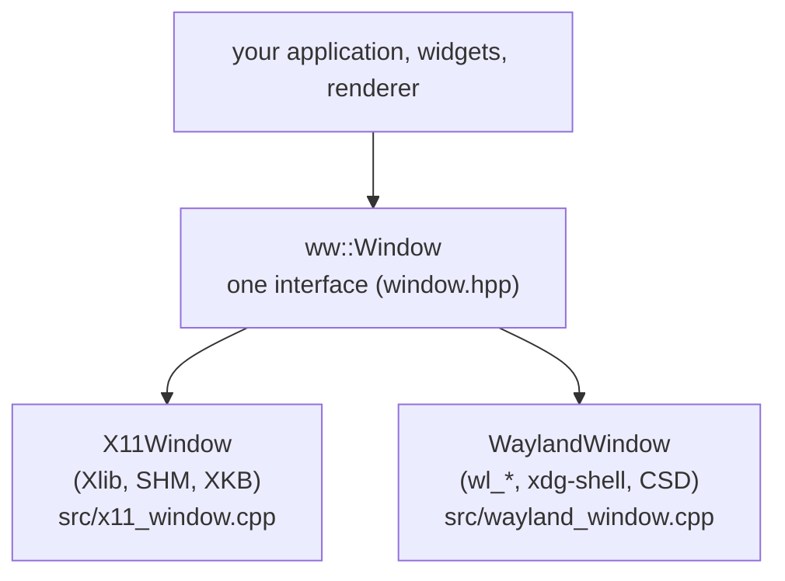
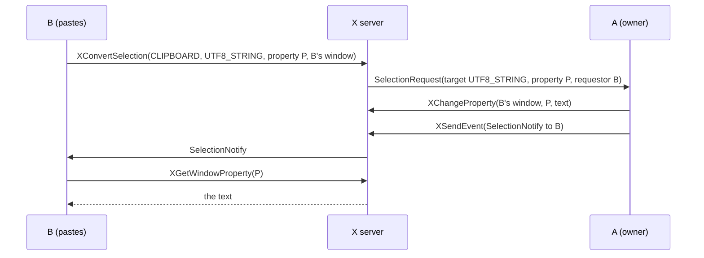
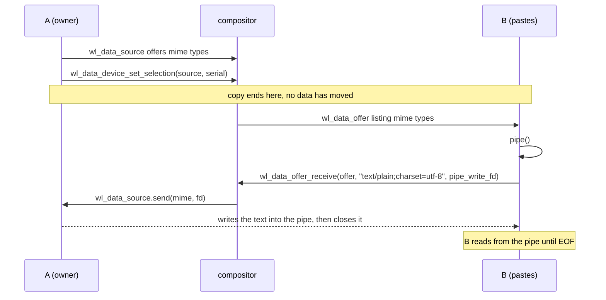

# Chapter 8. A platform layer over two backends

**You will learn**

- How to design a small interface that hides X11 and Wayland from the rest of the program
- Why a closed event variant and a pull style event API are a good fit
- How the two backends implement the same contract (framebuffer, events, cursor, clipboard)
- How clipboard transfer works on each system, and why it is the hardest part
- How to choose a backend at run time and fall back safely

**Code for this chapter:** `lib/platform/` and `p06_platform_layer/main.cpp`.

---

## 8.1 Why a layer at all

Stages 1 to 5 are two separate programs doing the same job. If you now wrote widgets, text editing and layout on top, you would have to write them twice. The fix is the classic one: define the smallest interface that both systems can satisfy and write everything else against it.



Good platform layers are **small** and **opinionated**. This one does not expose child windows, multiple monitors, drag and drop or GPU contexts. It does windows with a CPU pixel buffer, input, a cursor and the text clipboard, and does them thoroughly.

## 8.2 The interface

Read `lib/platform/include/ww/window.hpp` in full. It is about 90 lines, and the rest of the book depends on every one of them.

```cpp
class Window {
public:
    static std::unique_ptr<Window> create(const WindowConfig&, Backend = Backend::Auto);

    virtual bool waitEvent(Event& out, int timeoutMs) = 0;
    bool pollEvent(Event& out) { return waitEvent(out, 0); }

    virtual Framebuffer acquireFramebuffer() = 0;
    virtual void present() = 0;

    virtual int widthPx() const = 0;  virtual int heightPx() const = 0;  virtual float scale() const = 0;

    virtual void setTitle(const std::string&) = 0;
    virtual void setCursor(Cursor) = 0;

    virtual void setClipboardText(const std::string&) = 0;
    virtual std::string clipboardText() = 0;
};
```

### Decision 1: pull, not push

Callbacks or an observer list would force the application to restructure around them. A **pull** API (`waitEvent`) keeps the application's loop in the application's hands:

```cpp
ww::Event ev;
while (window->waitEvent(ev, timeoutMs)) { ... }
```

The loop is easy to read, easy to test, and easy to put a timer into (`timeoutMs`).

### Decision 2: `waitEvent` with a timeout

`-1` blocks until something happens (zero CPU), `0` polls, and a positive value waits at most that long, returning `false` on timeout. The UI toolkit uses the timeout for the caret blink: it tells the loop "wake me in 340 ms", otherwise sleeps forever. The whole "idle app uses no CPU" property comes from this one parameter.

### Decision 3: a closed `std::variant` of events

```cpp
using Event = std::variant<CloseEvent, RedrawEvent, ResizeEvent, FocusEvent, MouseMoveEvent,
                           MouseLeaveEvent, MouseButtonEvent, ScrollEvent, KeyEvent, TextEvent>;
```

Each alternative is a plain struct. Application code handles them with `std::get_if`, `std::holds_alternative` or `std::visit`. Compared with a base class and `dynamic_cast`, or an enum with a union, the variant is type safe, has no heap allocation (except the string in `TextEvent`) and the compiler warns when you forget a case in a `visit`.

Events use **logical units** and platform neutral types:

- Mouse coordinates are floats in **logical pixels** (the unit of layout).
- `Key` is our own enum (letters and digits equal their ASCII value, `Key::A == 'a'`), not an X keysym or Linux evdev code. `key_translate.cpp` converts an xkb keysym into it.
- `KeyEvent` is a command (arrow, Enter, Ctrl+C). `TextEvent` is typed text in UTF-8. The split you learnt in chapter 4 lives in the type system.
- `ResizeEvent` reports the framebuffer size **in pixels** and the scale, because the application needs both: pixels to size its buffer, scale to convert.

### Decision 4: the framebuffer format

```cpp
struct Framebuffer {
    uint32_t* pixels; int width; int height; int stride; float scale;
};
```

The format is fixed to `0xAARRGGBB` in native byte order, which is Cairo's `ARGB32` and what both `XRGB8888` (X11/Wayland) and the renderer want. The window layer **always** hands out this layout and the layer converts if the server did not support it. Alpha must be `0xFF`.

`acquireFramebuffer()` returns a buffer for the current size. `present()` hands it to the system. The caller never thinks about SHM segments, Wayland buffer pools or release events. Those are the layer's problem, which is the point.

## 8.3 Sharing code between backends

`window_base.hpp` collects the things both backends do the same way:

- **An event queue** (`std::deque<Event>` with `push` and `pop`). Backends translate native events and push; `waitEvent` pops.
- **ClickTracker**, which counts single, double and triple clicks the same way on both (same spot within 4 logical pixels, within 400 ms). Each system has its own notion of double click, and mixing them would make behaviour differ per backend, so we do it once ourselves.
- **`scaleFromEnvironment()`**, which reads `WW_SCALE`.
- **`msUntil(deadline)`**, the time left until a point on the steady clock.

Note what is not shared: the main loops. X11 polls one fd with Xlib's quirks, Wayland needs the `prepare_read` dance. Forcing them into a shared loop would cost more clarity than the duplicate would.

## 8.4 Choosing a backend

`src/window.cpp` is only 54 lines and shows the policy:

1. If the caller or the environment (`WW_BACKEND=x11|wayland`) names a backend, use that and nothing else.
2. Otherwise (Auto): if `WAYLAND_DISPLAY` is set, try Wayland. If creating the window fails (compositor missing, protocol absent), print a message and **fall back to X11**.
3. If neither works, return `nullptr` with a message on stderr.

Conditional compilation (`WW_HAVE_X11`, `WW_HAVE_WAYLAND`) means the same source builds when one backend is disabled in CMake.

Two details worth copying:

- `Window::create` returns `std::unique_ptr<Window>`. A failure is a null pointer plus an explanation, never an exception thrown out of a C callback.
- The factory is the only place that knows about both backends. Application code includes `ww/window.hpp` and nothing else.

## 8.5 How the X11 backend satisfies the contract

Everything here is chapters 3 to 5 reorganised.

| Contract | X11 implementation |
|---|---|
| `waitEvent` | Drain Xlib events into the queue, then `poll(ConnectionNumber)` with the remaining time |
| Framebuffer | `XFramebuffer` with MIT-SHM, falling back to `XPutImage`. `acquireFramebuffer` first waits for the previous `ShmCompletion`, so you can never draw into a buffer the server is reading |
| Resize | `ConfigureNotify` updates the size, the next `acquireFramebuffer` re-creates the buffer |
| Keyboard | xkbcommon-x11, with `XkbSetDetectableAutoRepeat` and `XkbStateNotify` driving `xkb_state_update_mask`, and `XkbNewKeyboardNotify` reloading the keymap when layouts change |
| Scale | Reads `Xft.dpi` from the X resource database (`XrmGetResource`), `dpi / 96`, clamped to 1 to 4 and rounded to the nearest quarter (so 1.0, 1.25, 1.5 ...). Fractional scales work here because on X11 the application does the scaling itself |
| Cursor | Core cursors created from the standard cursor font and `XDefineCursor` |

The `acquireFramebuffer` rule shows the benefit of the layer. In stage 3 the application tracked `inFlight`. Here it disappears into the backend, and the application just draws then presents.

## 8.6 How the Wayland backend satisfies the contract

Everything here is chapters 6 and 7 reorganised, with one big addition, **decorations drawn by the library** when the compositor does not provide them. The pieces:

- The pending **configure** state is collected (size, maximised, fullscreen, tiled) and applied once on the closing `xdg_surface.configure`. Window geometry is recomputed (`recomputeContent`) so the *content* size excludes our title bar and border.
- `ResizeEvent` is pushed only when the content size or scale changed.
- The buffer pool (`kMaxBuffers = 3`) with busy flags.
- Decorations in `drawDecorations`, drawn with Cairo and Pango (that is why `lib/platform` links Pango privately), with hit zones from `zoneAt`.
- Scroll events are gathered and flushed on `wl_pointer.frame`, so a diagonal scroll arrives as one event.
- `updateScale()` as described in chapter 7.
- `WW_SCALE` is honoured so you can test HiDPI on a regular monitor.

A subtle but important design choice sits here. The application asks for a *content* size, and the library adds whatever frame is needed. The application never learns whether a title bar was drawn by the compositor or by us.

## 8.7 The clipboard

The clipboard needs two operations: copy (`setClipboardText`) and paste (`clipboardText`). On both systems, **copy does not send the data**. It announces "I own the clipboard and can offer these formats". The data is transferred later, only if someone pastes, directly between the two programs. That is also why a copied text disappears if the source program exits (unless a clipboard manager grabs it).

### X11: selections

X11 clipboard rules are in the ICCCM and live on **atoms** and **window properties**:



The code:

- `setClipboardText` stores a copy of the string and calls `XSetSelectionOwner(CLIPBOARD, window)`.
- When another program asks, `SelectionRequest` arrives in the event loop and `answerSelectionRequest` replies. It must also answer `TARGETS` (the list of supported formats) or many programs will refuse to paste.
- `clipboardText` calls `XConvertSelection`, then **pumps events until `SelectionNotify` arrives** or 500 ms pass, then reads the property.
- If we own the clipboard ourselves, we return our own copy without any round trip.

Limits: this implementation does not support **INCR**, the chunked protocol for large selections, and it handles only `UTF8_STRING`. It also treats only `CLIPBOARD` (Ctrl+C and Ctrl+V), not `PRIMARY` (middle click paste).

### Wayland: data devices and file descriptors



The data goes through a **pipe**, never through the compositor, which only forwards the file descriptor. The reader knows the transfer ended when `read` returns 0. Our code:

```cpp
wl_data_offer_receive(selectionOffer_, mime, fds[1]);
close(fds[1]);                 // so we see EOF when the source closes its end
wl_display_flush(display_);
... poll the read end with a 500 ms deadline, read 4096 bytes at a time ...
```

It picks the best mime type from a preference list (`text/plain;charset=utf-8`, `UTF8_STRING`, `text/plain`, `TEXT`, `STRING`), caps the result at 16 MB, and handles the case where we own the selection.

Two protocol details to know:

- **Setting** the selection needs the **serial** of a recent input event (the same authorisation idea as window moves). You cannot set the clipboard from a background program.
- A Wayland client may only **read** the selection while it has keyboard focus (the compositor sends the offer on focus). A background program cannot snoop on the clipboard.

### The deadline

Both implementations block in `clipboardText()` for up to about half a second. The other program may be slow, hung, or gone. A blocking read with no timeout would freeze your UI, and even this short block is visible. A production design makes paste **asynchronous**: start the request, return, and deliver the text as an event. We keep the simple version and document the limit.

## 8.8 Stage 6: the demo

`p06_platform_layer/main.cpp` is a 175 line program that runs unchanged on X11 and Wayland. It:

- Creates the window with `ww::Window::create(config)`, and accepts `--x11` or `--wayland`.
- Logs every event type.
- Draws an animated surface directly into `fb.pixels` (no Cairo yet).
- Copies "Hello from stage 6" on **C** and prints the clipboard on **V**.
- Changes the cursor between arrow, I-beam and hand depending on where the mouse is.

Compare it with stage 3 and stage 5 side by side. The application is now about as long as stage 3 alone, but does what both did, on both systems.

## 8.9 Testing the layer

You verify two things: that each backend does the right thing, and that they behave the same. Practical routes:

- **X11** under `Xvfb`, driven with `xdotool` (move the mouse, type, resize), screenshotted with ImageMagick's `import`.
- **Wayland** under a headless `weston`, with `WAYLAND_DEBUG=1` to check the protocol traffic (for example that the buffer is created at scale 2 when `WW_SCALE=2`). A headless compositor has no input devices, so pointer and keyboard code can only be reviewed and compiled, not exercised. On a real session, run the stage by hand.
- **Differences**: write down the observable behaviour in a table (double click time, key repeat, scroll units) and verify each cell on each backend.

An honest summary of this repository: the X11 path was exercised end to end under Xvfb. The Wayland window creation, buffer and scale paths were exercised under a headless compositor. The Wayland pointer, keyboard and drawn title bar are reviewed and compiled but need your testing on a real Wayland session.

## Pitfalls

- **Leaking backend types through the interface.** If `X11` or `wl_` appears in a public header, the layer failed.
- **Letting backends disagree.** Double click timing, scroll sign, modifier names. Normalise in one place.
- **Blocking the loop on clipboard reads.**
- **Reporting sizes in different units.** Decide once: events in logical coordinates, buffers in pixels.
- **Dropping the event queue on resize.** Resize must preserve queued input.
- **Assuming a null `Window` cannot happen.** Compositors vanish, and `DISPLAY` is not always set.

## Review questions

1. Why is a pull style `waitEvent` better than registering callbacks for this project?
2. Why does `ResizeEvent` carry pixels while mouse events carry logical coordinates?
3. In which function does each backend wait for the previous frame to be released?
4. What does the clipboard owner actually send when the user presses Ctrl+C?
5. What would break if `clipboardText()` had no timeout?

## Exercises

**Ex 8.1** Run `p06_platform_layer` with `--x11` and `--wayland` (if available), then with `WW_SCALE=2`. Describe the differences in the logged events.

**Ex 8.2** Add a `setFullscreen(bool)` method to `ww::Window`. Describe the X11 implementation (`_NET_WM_STATE` client message) and the Wayland one (`xdg_toplevel_set_fullscreen`). Implement one of them.

**Ex 8.3** Extend `Cursor` with a `ResizeHorizontal` shape. List every file that needs a change, and the cursor names to use on each backend (`sb_h_double_arrow`, `ew-resize`).

**Ex 8.4** Add a `bool hasFocus() const`. Where does each backend learn about focus?

**Ex 8.5** Make `clipboardText()` asynchronous: add `requestClipboardText()` and a `ClipboardEvent{std::string text}`. Sketch the state machine for each backend.

**Ex 8.6** Write a tiny "null backend" implementing `ww::Window` that returns scripted events from a vector and a memory framebuffer. Use it to unit test application logic without any display. What do you need to add to the factory?

Solutions: [solutions/ch08.md](solutions/ch08.md)

Previous: [Chapter 7](07-wayland-input-and-decorations.md) | Next: [Chapter 9, 2D rendering](09-rendering-with-cairo-and-pango.md)
