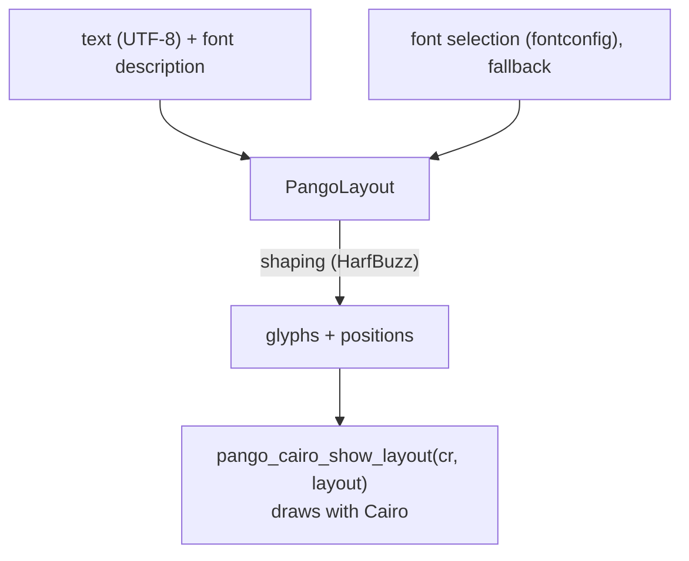

# Chapter 9. 2D rendering with Cairo and Pango

**You will learn**

- Why we stop hand writing pixel loops, and what a vector renderer gives you
- How Cairo draws into the framebuffer we already own, and how its state model works
- Pixel formats, premultiplied alpha, and why pixel perfect lines need half pixel care
- How text works: fonts, shaping, layout, measuring, caret positions and hit testing
- How HiDPI scaling falls out of one call, and how clipping works
- How to design a small renderer interface that could later be replaced

**Code for this chapter:** `lib/renderer/` (`renderer.hpp`, `renderer.cpp`) and `p07_renderer/main.cpp`.

---

## 9.1 Why not keep writing pixels?

In stage 3 we wrote a rectangle fill by hand, and in the exercise a Bresenham line. Imagine continuing: rounded corners, anti-aliased circles, gradients, shadows, clipping, and then **text**. Text alone needs font file parsing, glyph rasterisation, kerning, ligatures, fallback fonts for characters the main font lacks, right to left scripts, and combining marks. That is years of work.

So we use two libraries, each of which does one thing:

- **Cairo** is a 2D vector graphics library. You describe paths (lines, arcs, rectangles), then fill or stroke them with a colour or gradient. Cairo rasterises with anti-aliasing into a pixel buffer.
- **Pango** lays out text. Given a string and a font description it chooses fonts, shapes glyphs (through HarfBuzz), breaks lines if asked, and tells you the size and the position of each character. It draws using Cairo.

Neither one is a UI toolkit. They do not know what a button is. They are exactly the layer between "pixel buffer" and "widgets" that we need.

## 9.2 Cairo's model in five minutes

Cairo works with three ideas.

**Surface.** Where pixels go. We create an *image surface* on top of memory we already own, the window's framebuffer:

```cpp
cairo_surface_t* surface = cairo_image_surface_create_for_data(
    (unsigned char*)fb.pixels, CAIRO_FORMAT_ARGB32, fb.width, fb.height, fb.stride);
```

No copy is made. Cairo writes straight into the same bytes that the platform layer shares with the display server. That is why the platform layer's framebuffer format is fixed to Cairo's `ARGB32`.

**Context (`cairo_t*`).** The drawing state: current colour, line width, current path, transform, clip. You create one per surface:

```cpp
cairo_t* cr = cairo_create(surface);
```

**Path, then paint.** Drawing is two steps. First build a path, then fill or stroke it:

```cpp
cairo_rectangle(cr, x, y, w, h);          // build a path
cairo_set_source_rgba(cr, r, g, b, a);    // choose the "ink"
cairo_fill(cr);                           // paint the inside of the path
```

`cairo_stroke` draws the outline with the current line width instead. Because the path is separate from the painting, one path can be both filled and stroked, and a clip is just "a path that limits where painting may happen".

## 9.3 Pixel formats and premultiplied alpha

`CAIRO_FORMAT_ARGB32` stores a pixel as a native endian 32 bit word `0xAARRGGBB` with **premultiplied alpha**: the stored R, G, B are already multiplied by A. A 50 percent transparent red is `0x80800000`, not `0x80FF0000`. Premultiplication makes blending cheaper and is what every modern compositor expects.

Practical rules:

- Our window buffers must be fully opaque (`alpha = 0xFF`). For opaque pixels premultiplied and straight values are the same.
- Draw translucent shapes with `cairo_set_source_rgba` and Cairo handles the maths.
- If you ever write pixels by hand into an ARGB buffer with alpha below 255, premultiply first.
- `Renderer::clear` uses `CAIRO_OPERATOR_SOURCE`, which **replaces** the buffer contents instead of blending with whatever was there. Otherwise a translucent clear colour would mix with the previous frame.

## 9.4 Strokes and half pixels

A stroke is centred on its path. A 1 pixel line along `y = 10.0` covers half of row 9 and half of row 10, so anti-aliasing turns it into a blurry 2 pixel grey line. A line along `y = 10.5` covers exactly row 10 and is crisp.

The renderer avoids this trap for rectangles:

```cpp
void Renderer::strokeRect(Rect r, Color color, float lineWidth) {
    const Rect inner = r.inset(lineWidth / 2.0f);   // stroke is centred on the path: keep it inside r
    cairo_rectangle(cr, inner.x, inner.y, inner.w, inner.h);
    cairo_stroke(cr);
}
```

The stroke is inset by half the line width so the visible border lies **inside** the rectangle you asked for. That makes layout easy to reason about: a bordered box of size 100 x 30 occupies exactly 100 x 30, and neighbours do not overlap. When you use whole number coordinates and an odd line width, you also get crisp one pixel edges.

(On HiDPI scales the "pixel" is a device pixel, so `y = 10.5` is not always the answer. The UI layer snaps coordinates in a few places, and the rule is the same: know where your edges fall.)

## 9.5 Shapes

The renderer's drawing calls and how they map to Cairo:

| Renderer call | Cairo path |
|---|---|
| `fillRect` | `cairo_rectangle`, `cairo_fill` |
| `fillRoundRect` | four `cairo_arc` calls joined into one closed path |
| `strokeRoundRect` | same path, inset, `cairo_stroke` |
| `fillRoundRectGradient` | `cairo_pattern_create_linear` with two colour stops, set as source |
| `fillCircle`, `strokeCircle` | `cairo_arc` around a full circle |
| `fillTriangle` | `move_to`, two `line_to`, `close_path` |
| `line` | `move_to`, `line_to`, `stroke` with round caps |
| `shadow` | stacked translucent rounded rectangles (see below) |

**Rounded rectangles.** Start at the top right corner. Each `cairo_arc(cx, cy, r, from, to)` continues the path with a quarter circle, and Cairo adds the straight edges between arcs automatically. The radius is clamped to half of the shorter side, so a radius larger than the rectangle produces a pill instead of an error. In stage 7, a rectangle 50 high with radius 25 draws the pill shape.

**Gradients** are patterns. A pattern is an alternative "ink". You create one, add colour stops, set it as the source, then paint any path with it.

**Shadows.** True Gaussian blur is expensive. The renderer fakes a soft shadow by drawing eight stacked rounded rectangles, each larger and fainter. It is cheap, needs no extra buffer, and looks fine behind cards and popups. If you need accurate blur, render the shadow to a small off screen surface, blur it, and cache it as an image.

## 9.6 Text with Pango

### The pieces



- A **PangoLayout** holds one piece of text and its formatting. Create one from the Cairo context with `pango_cairo_create_layout(cr)`.
- A **PangoFontDescription** names a family, weight, style and size.
- **Fontconfig** finds a real font file for the description and substitutes for missing glyphs.
- **Shaping** turns characters into glyphs. It is not one to one: "ffi" may become a ligature glyph, Arabic letters change shape by position, and combining accents attach to their base.

### Fonts in code

```cpp
struct Font { std::string family = "Sans"; float size = 14.0f; bool bold = false; bool italic = false; };
```

The renderer turns each distinct font into a `PangoFontDescription` once and caches it in a hash map keyed by family, size and style. Creating descriptions every frame would be wasteful.

```cpp
pango_font_description_set_absolute_size(desc, size * PANGO_SCALE);
```

**Absolute size** means size in device units (here, logical pixels), not points. Points depend on a DPI assumption that we do not want. Pango measures in units of 1/1024 pixel (`PANGO_SCALE = 1024`), so you multiply on the way in and divide on the way out.

Family `"Sans"` is an alias that fontconfig resolves to the user's default sans serif font. Characters that font lacks (for example Japanese or emoji) fall back to another installed font automatically. That is the reason the stage 7 demo can draw Latin, Greek, Cyrillic, Japanese and Arabic in one line.

### Drawing

```cpp
void Renderer::drawText(float x, float y, std::string_view text, const Font& font, Color color) {
    prepareText(text, font);         // set text and font on the shared layout
    setColor(color);
    cairo_move_to(cr, x, y);
    pango_cairo_show_layout(cr, layout);
}
```

`(x, y)` is the **top left corner of the text box**, not the baseline. This matches how layout code thinks, and differs from `cairo_show_text` where the point is on the baseline. One shared layout object is reused for every call.

### Measuring

Layout needs to know how big text will be before it is drawn (to size a button, or centre a label):

```cpp
TextSize Renderer::measureText(std::string_view text, const Font& font) {
    prepareText(text, font);
    PangoRectangle logical;
    pango_layout_get_extents(layout, nullptr, &logical);
    return {logical.width / (float)PANGO_SCALE, logical.height / (float)PANGO_SCALE};
}
```

The **logical** extents are the space the text occupies for layout purposes (line height, advance widths). The **ink** extents (the first, null argument) are the tight bounding box of the actual drawn pixels. For layout always use logical extents. Using ink would make a label that has no descenders shorter than one that has, and the UI would jiggle as text changes.

### Carets and hit testing

A text field needs two mappings between a **byte index** in the UTF-8 string and an **x position**:

```cpp
float  caretX(text, font, byteIndex);   // where to draw the caret
size_t indexAtX(text, font, x);         // which character boundary is closest to a click
```

They use `pango_layout_index_to_pos` and `pango_layout_xy_to_index`. The second returns an index and a `trailing` count: how far into the character at that index the click landed. If the click is on the right half of a character, the caret belongs after it, so the code advances by `trailing` UTF-8 characters:

```cpp
const char* p = g_utf8_offset_to_pointer(base + index, trailing);
return p - base;
```

Why this matters: **bytes are not characters.** In UTF-8, "é" is two bytes. A caret index in the middle of a character produces invalid text. These two functions always return boundaries between characters, and the text editing code in chapter 10 steps over whole characters using the same rule.

Note the limit: Pango handles *grapheme clusters* and bidirectional text correctly in its own functions, but our editing code moves by code point. A flag emoji or a letter with several combining marks may need two presses to delete. Chapter 13 returns to this.

## 9.7 HiDPI in one call

```cpp
cairo_surface_set_device_scale(surface, fb.scale, fb.scale);
```

After this call, every coordinate you give Cairo is multiplied by `scale` on its way to the pixels. The renderer's `width()` returns `widthPx / scale`. Drawing code works in **logical pixels** and the same code is crisp on a 2x display, since lines, curves and text are re-rasterised at the higher resolution rather than stretched. This single line is why the rest of the application never contains a scale factor.

For text, Pango and Cairo then pick glyph sizes in device pixels, so on a 2x display a 14 pixel font renders 28 device pixels tall with full detail.

### Font rendering options

```cpp
cairo_font_options_set_antialias(options, CAIRO_ANTIALIAS_GRAY);
cairo_font_options_set_hint_style(options, CAIRO_HINT_STYLE_SLIGHT);
cairo_font_options_set_hint_metrics(options, CAIRO_HINT_METRICS_ON);
```

- **Grayscale anti-aliasing** instead of LCD sub pixel rendering. Sub pixel text assumes an opaque background and a known sub pixel order, and does not work reliably on the translucent or scaled surfaces we sometimes draw to. Most modern toolkits use grayscale too.
- **Slight hinting** nudges outlines vertically to the pixel grid for sharper text without distorting letter shapes.
- **Hint metrics** rounds advance widths so the same string always measures the same.

## 9.8 Clipping

Clipping restricts drawing to a rectangle. Cairo does it with the state stack:

```cpp
void Renderer::pushClip(Rect r) {
    cairo_save(cr);
    cairo_rectangle(cr, r.x, r.y, r.w, r.h);
    cairo_clip(cr);
}
void Renderer::popClip() { cairo_restore(cr); }
```

`cairo_save` pushes the whole drawing state, and `cairo_restore` pops it, including the clip. Clips **nest** by intersection, so pushing a scroll area's rectangle inside a card's rectangle clips to the overlap. Every `pushClip` must be paired with a `popClip`. The UI uses this for scroll areas, text fields (so long text does not spill out), and popup lists.

## 9.9 One Renderer per frame

The `Renderer` constructor wraps a `Framebuffer`: it creates a Cairo surface and context over the pixels and a Pango layout. The application constructs one each frame:

```cpp
ww::Framebuffer fb = window->acquireFramebuffer();
ww::Renderer renderer(fb);
...
window->present();
```

Creating it is cheap, and it means the renderer never holds a pointer into a buffer that the platform layer has since moved or released. The fonts cache lives inside the renderer, so it is rebuilt every frame in this simple design. If profiling shows that cost, move the cache out into a longer lived object.

## 9.10 Off screen rendering

`OffscreenSurface` is a `Framebuffer` backed by a plain `std::vector<uint32_t>`. With it you can render without any window:

```cpp
ww::OffscreenSurface surface(720, 560, 1.0f);
ww::Renderer renderer(surface.framebuffer());
drawScene(renderer);
renderer.savePng("out.png");
```

This is how stage 7's `--screenshot` option works, how the book's author checked that the widget gallery looked right on a server with no display, and how the UI tests of chapter 12 can render real frames. A renderer you can run headless is a renderer you can test.

## 9.11 Keeping the interface replaceable

`renderer.hpp` exposes about twenty functions and none of them mentions Cairo or Pango. Its types are our own (`Color`, `Rect`, `Font`). The implementation hides behind a pointer to an implementation struct (the **pimpl** idiom), which also keeps `cairo.h` and Pango headers out of every file that draws.

Why do this?

- You may later want your own rasteriser to learn how it works. Write `class Renderer` again with the same public functions, change one line in CMake, and nothing above it changes.
- You may want a GPU renderer (chapter 13). The UI would not care.
- The headers stay small and compile faster.

The cost is one level of indirection per call. In a UI that draws a few hundred shapes per frame, that is not measurable.

## Pitfalls

- **Forgetting that strokes straddle the path.** Blurry lines are nearly always a half pixel problem.
- **Mixing premultiplied and straight alpha** when touching pixels directly.
- **Measuring with ink extents.** Layouts jitter.
- **Treating text byte offsets as character counts.**
- **Calling `pushClip` without `popClip`** after an early return. Prefer a small RAII guard in your own code.
- **Creating fonts and layouts every call.** Cache them.
- **Using points, not pixels, for font sizes** and then wondering why text size differs across machines.
- **Drawing with the LCD sub pixel mode on a translucent buffer**, which produces colour fringes.
- **Not pairing every `cairo_save` with a restore.** The state stack grows and clips leak.

## Review questions

1. Why can Cairo draw straight into the window's pixels without copying?
2. What does premultiplied alpha mean, and what is the stored value of 50 percent opaque pure green?
3. Why does a one pixel stroke at integer coordinates look blurry, and what does `strokeRect` do about it?
4. What is the difference between logical and ink extents? Which do you use for layout?
5. What does `trailing` mean in `pango_layout_xy_to_index`?
6. How does one call to `cairo_surface_set_device_scale` make the rest of the program HiDPI aware?

## Exercises

**Ex 9.1** Run `p07_renderer --screenshot out.png`. Open the PNG and identify each primitive from the table in section 9.5.

**Ex 9.2** Add a `fillEllipse(cx, cy, rx, ry, color)` to the renderer. Hint: scale the Cairo context inside a `save` and `restore`, then draw a unit circle.

**Ex 9.3** Add `drawTextCentered(Rect box, text, font, color)` built from `measureText` and `drawText`. Show it inside a button sized to fit the text with 12 pixels of padding.

**Ex 9.4** In stage 7, change the demo's line width from 1 to 2 and to 3 for `strokeRect`, and use `savePng` at scale 1 and at scale 2 (`OffscreenSurface(720, 560, 2.0f)`). Compare edge sharpness.

**Ex 9.5** Write a function that finds the largest font size at which a string still fits a given width, using `measureText`. Use a binary search.

**Ex 9.6** Add a `Renderer::drawImage` that blits an ARGB32 `std::vector<uint32_t>` at a position, using `cairo_image_surface_create_for_data` and `cairo_set_source_surface`. Test it with a small checkerboard.

**Ex 9.7** (Harder) Replace `shadow` with a real blurred shadow: draw a black rounded rectangle into a small off screen surface, apply a box blur three times, and paint it with a colour mask. Compare speed and look.

Solutions: [solutions/ch09.md](solutions/ch09.md)

Previous: [Chapter 8](08-platform-layer.md) | Next: [Chapter 10, immediate mode UI](10-immediate-mode-ui.md)
