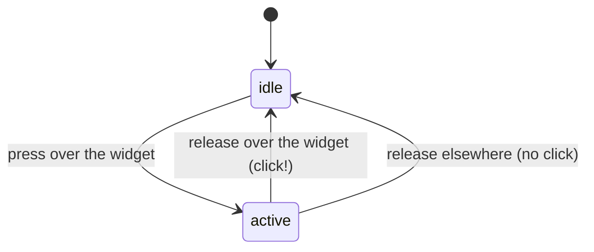

# Chapter 10. An immediate mode UI toolkit

**You will learn**

- What immediate mode means, and how it differs from the retained mode toolkits you know
- How widgets get identities without objects (ids and the id stack)
- The hot, active and focus model that makes buttons, sliders and keyboard navigation work
- How a layout stack of rows, columns, cards and scroll areas places widgets
- Why a frame sometimes needs two passes, and how the toolkit settles
- How a text field handles selection, clipboard, UTF-8 and the blinking caret
- How an idle application uses no CPU

**Code for this chapter:** `lib/ui/include/ww/ui.hpp`, `lib/ui/src/ui.cpp` (1140 lines), and `p08_widgets/gallery.hpp` (the widget gallery as a single function).

---

## 10.1 Two ways to build a UI

**Retained mode** is what Qt, GTK and the web DOM do. You create widget objects (`new Button("Save")`), attach them to a tree, connect callbacks, and the toolkit keeps the tree and decides when to redraw.

```cpp
auto* save = new Button("Save");
save->onClick([&] { document.save(); });
layout->addWidget(save);
```

**Immediate mode** has no widget objects. Every frame your code **describes** the UI by calling functions, and each call draws the widget and returns what the user did with it.

```cpp
if (ui.button("Save")) document.save();
```

That one line is the whole story. There is no object to create, store, update or delete. Your application owns all data (`document`, `darkMode`, `name`), and the toolkit only borrows it for the duration of the call.

```cpp
ui.checkbox("Dark mode", darkMode);      // reads and writes your bool
ui.textField("name", name);              // reads and writes your std::string
ui.slider("volume", volume, 0.0f, 1.0f); // reads and writes your float
```

### Trade offs

| | Retained | Immediate |
|---|---|---|
| State | Duplicated in widgets and in your data | One copy, yours |
| Keeping UI in sync | Write update code and signals | Impossible to get out of sync, you re-describe it each frame |
| Dynamic UI (lists that change, show or hide) | Add, remove, re-layout objects | An `if` or a `for` |
| Cost per frame | Only changed widgets | Everything is rebuilt (cheap for hundreds of widgets, costly for tens of thousands) |
| Rich features (accessibility trees, animation, styling, text shaping) | Mature | Harder, you build them |
| Code size for simple tools | Larger | Much smaller |

Immediate mode is why Dear ImGui is loved for tools and debug panels, and why many game engine editors use it. It is a bad fit for something like a word processor with ten thousand elements and screen reader support. For learning, it has a huge advantage: **the whole toolkit fits in your head**, and you can read every line.

## 10.2 The frame cycle

The application loop, from `p08_widgets/main.cpp`:

```cpp
while (running) {
    // 1. wait for input or the next caret blink
    bool have = window->waitEvent(ev, ui.nextWakeupMs());
    if (!have) dirty = true;                       // timer expired
    while (have) {
        if (CloseEvent) running = false;
        else if (ResizeEvent or RedrawEvent) dirty = true;
        else { ui.handleEvent(ev); dirty = hadInput = true; }
        have = window->pollEvent(ev);
    }
    if (!dirty) continue;

    // 2. draw
    ww::Framebuffer fb = window->acquireFramebuffer();
    ww::Renderer renderer(fb);
    ww::ui::drawFrame(ui, renderer, [&](ww::ui::Context& u) { gallery::build(u, state); }, hadInput);
    window->setCursor(ui.cursor());
    window->present();
    dirty = hadInput = false;
}
```

Two phases:

1. **Event phase.** `ui.handleEvent(ev)` does not run any widget code. It only records input into a small `Input` struct: mouse position, which buttons went down or up *since the last frame*, scroll amount, and a list of key and text events.
2. **Draw phase.** Your `build` function runs. Every widget call reads that recorded input, decides what happened to it, draws itself, and returns the result.

Because input is recorded and consumed once per frame, a click is seen **exactly once**: `pressed[0]` is true during the first frame after the press, and `endFrame` clears it.

Inside `drawFrame`:

```cpp
ui.beginFrame(renderer);   // clear the screen, reset layout and per frame state
build(ui);                 // your widget calls
ui.endFrame();             // draw overlays, resolve focus, clear one-shot input
```

## 10.3 Widget identity

If there are no objects, how does the toolkit know that the button drawn this frame is the same one as last frame? Through **ids**.

Each widget call computes an id from the label or an explicit string:

```cpp
Id Context::makeId(std::string_view label) const {
    return hashString(label, idStack_.empty() ? 0 : idStack_.back());
}
```

`hashString` is FNV-1a, a very small hash: for each byte, XOR then multiply by a prime. It is fast, has good spread for short strings, and is easy to read.

The ids drive everything that has to survive between frames: which widget is pressed, which has the keyboard focus, each text field's caret, each scroll area's offset.

Rules you must know:

- **Two widgets with the same label collide.** Two buttons labelled "Delete" would share state. Add a hidden suffix: `"Delete##3"`. Everything after `##` is part of the id but is not displayed (`displayText` strips it).
- **In loops, push an id.** `ui.pushId(i); ... ui.popId();` hashes the index into every id inside. This gives each row of a list its own identity.
- **The id is not the position.** Move a widget around (in a different branch of an `if`) and, if the label is the same, it keeps its state.

```cpp
for (int i = 0; i < items.size(); ++i) {
    ui.pushId(i);
    if (ui.button("Remove")) toRemove = i;     // unique per row thanks to pushId
    ui.popId();
}
```

## 10.4 Hot, active and focus

Three ids in the context describe the interaction:

- **Hot**: the widget under the mouse (it highlights).
- **Active**: the widget currently being pressed. It stays active until the mouse button is released, **even if the mouse leaves the widget**. That is what makes a slider keep dragging when the pointer strays outside it, and a button cancel its click when you drag away.
- **Focus**: the widget that receives the keyboard.

The core logic is one function used by buttons, checkboxes, radios and tabs:

```cpp
bool Context::clickBehavior(Id id, Rect r, bool& hover, bool& held) {
    hover = enabled() && hovered(r);
    if (hover && input_.pressed[0] && activeId_ == 0) {   // press began on this widget
        activeId_ = id;
        focusId_ = id;
        pressClaimed_ = true;
    }
    bool clicked = false;
    if (activeId_ == id && input_.released[0]) {          // release: it is a click only if still over it
        clicked = hover;
        activeId_ = 0;
    }
    held = activeId_ == id && (hover || input_.down[0]);
    return clicked;
}
```

Read it slowly, it is a **state machine** in six lines:



The `activeId_ == 0` check means that only one widget can claim a press, and `pressClaimed_` lets `endFrame` clear keyboard focus when you click on empty space (nobody claimed it).

### Hover and occlusion

`hovered(r)` is more than `r.contains(mouse)`:

```cpp
if (!r.contains(mouseX, mouseY)) return false;
if (!clipStack_.empty() && !clipStack_.back().contains(...)) return false;   // clipped away by a scroll area
if (popupOpenNow_ && popupRect_.contains(...)) return false;                 // covered by an open dropdown
```

A scrolled-out widget does not respond, and an open dropdown list blocks hovering of widgets drawn beneath it. Immediate mode has no z-order tree, so such rules have to be coded explicitly.

### Keyboard focus and Tab

Each focusable widget calls `registerFocusable(id)` as it is drawn, building a list of focusable ids *in drawing order*. Tab then needs no list at all, only the three variables `focusId_`, `lastFocusable_` and `firstFocusable_`:

- On Tab, the next widget that registers **after** the currently focused one takes focus.
- If Tab runs past the end, `endFrame` wraps to the first.
- Shift+Tab does the reverse using `lastFocusable_`.

A button with focus draws a ring and reacts to Enter or Space (`consumeKey`).

## 10.5 Drawing a widget, end to end

Here is the whole `button`, with commentary:

```cpp
bool Context::button(std::string_view labelText, bool primary) {
    const Id id = makeId(labelText);
    const std::string_view shown = displayText(labelText);
    const TextSize ts = measure(shown, theme_.font);
    const Rect r = allocate(std::ceil(ts.width) + 32, theme_.rowHeight);   // 1. layout: where am I?

    bool hover = false, held = false;
    bool clicked = clickBehavior(id, r, hover, held);                      // 2. input: what happened?
    registerFocusable(id);
    if (focused(id) && enabled() && (consumeKey(Key::Enter) || consumeKey(Key::Space))) clicked = true;
    if (hover) cursor_ = Cursor::Hand;

    Color fill = primary ? (held ? accentPressed : hover ? accentHover : accent)   // 3. draw
                         : (held ? widgetPressed : hover ? widgetHover : widget);
    renderer_->fillRoundRect(r, theme_.radius, dim(fill));
    ...
    return clicked;                                                        // 4. result
}
```

**Layout, input, draw, return.** Every widget has this shape, and a new widget is about 20 lines. Note the ordering subtlety: the widget draws **after** deciding what state it is in, so the frame in which you click already shows the pressed colour. There is no one frame lag.

`dim()` fades a colour if the widget is inside `beginDisabled()` / `endDisabled()`. A disabled widget skips input handling (`enabled() && hovered(r)`).

## 10.6 Layout

Immediate mode layout is a **cursor** that moves as widgets are placed. There is no tree to measure, so the layout is a simple stack discipline.

```cpp
struct Layout {
    Rect bounds;               // horizontal extent
    float x, y;                // the cursor
    bool horizontal;           // rows go left to right, otherwise top to bottom
    float rowTop, rowHeight, rowExtent;
    float startY;
    ...
};
```

`beginFrame` pushes a root layout (a vertical stack with padding). `allocate(naturalWidth, height)` is the single placement function:

- In a **vertical** stack, the widget goes at `(x, y)`, takes the full width unless told otherwise, and `y` advances by `height + spacing`.
- In a **horizontal** stack (a row), the widget goes at `(x, rowTop)`, takes its natural width, and `x` advances by `width + spacing`. Short widgets are centred vertically in the row.

The nesting calls push and pop a layout:

| Call | Effect |
|---|---|
| `beginRow(h)` / `endRow()` | children flow left to right; row height is the tallest child (or `h`) |
| `beginColumn(w)` / `endColumn()` | a vertical stack inside a row, `w` pixels wide or `-1` for the rest |
| `beginCard(title)` / `endCard()` | a padded, bordered panel with a heading |
| `beginScroll(id, h)` / `endScroll()` | a clipped, scrollable region of fixed height |

Width control: `ui.width(100)` sets the width of the **next widget only** (positive is fixed pixels, `-1` is "fill the rest", `0` is natural). That gives the typical form:

```cpp
ui.beginRow();
ui.width(80);  ui.label("Name");
ui.width(-1);  ui.textField("name", name);   // fills what is left
ui.endRow();
```

Right alignment uses two queries together, `availableWidth()` and `textWidth()`:

```cpp
ui.space(ui.availableWidth() - ui.textWidth(label) - 32);   // push the button to the right edge
if (ui.button(label)) ...
```

### The problem: sizes are known too late

A card draws its **background first** (so children appear on top), but its height depends on the children, which have not been placed yet. In a retained toolkit a measure pass would run before a draw pass. In immediate mode there is only one pass, so the toolkit cheats:

- During the frame, each card measures its content height and stores it in `cardHeightsNow_`.
- Its background in the **next** frame uses that stored height from `cardHeights_`.
- `endFrame` compares old and new. If any card changed by more than half a pixel, it sets `needsRedraw_`.

This means a layout can be **one frame late** when content changes (a tab switch, a collapsing section). Users would see a flash of a wrongly sized card. The fix is the settling loop.

## 10.7 Settling: the frame may run more than once

```cpp
template <typename BuildFn>
void drawFrame(Context& ui, Renderer& renderer, BuildFn&& build, bool hadInput) {
    const int minimumPasses = hadInput ? 2 : 1;
    int pass = 0;
    do {
        ui.beginFrame(renderer);
        build(ui);
        ui.endFrame();
        ++pass;
    } while (pass < minimumPasses || (ui.needsRedraw() && pass < 4));
}
```

Two reasons for extra passes:

1. **Layout settling.** If `needsRedraw()` is true (a card changed size, or Tab moved focus), run the build again. Up to four passes in total, which always converges for sane layouts.
2. **Input propagation.** After any input, run at least two passes. Consider a progress bar drawn *above* a slider that controls it. In the first pass the progress bar is drawn with the old value, then the slider moves. A second pass draws the bar with the new value. Without this, the bar lags behind the slider by one frame.

The cost is that the build function must be **idempotent**: calling it twice must not apply an action twice. Input is only consumed in the first pass (`endFrame` clears it), so clicks do not repeat, because the second pass sees no new press. Programs should still treat the build function as "draw and react", and put expensive or side effecting work outside it.

All this happens before `present()`. The user never sees the intermediate passes, only the last.

## 10.8 Scroll areas and clipping

A scroll area is a layout with a clip rectangle and an offset:

- `beginScroll` pushes a clip (`renderer.pushClip`) and shifts the cursor up by the stored offset.
- Children draw normally, positioned as if the content were fully visible. Anything outside the clip is simply not visible, and `hovered()` ignores it because of the clip check.
- `endScroll` measures how tall the content turned out to be, stores it in `ScrollState`, draws a scrollbar if content exceeds the view, and clamps the offset.
- The mouse wheel scrolls the **innermost** scroll area under the pointer, and `scrollConsumed_` prevents the event also scrolling the parent.

Content height is known only after the children are drawn, so the scrollbar thumb uses the previous frame's measurement. This is the same one frame lag as cards, and the same settling takes care of it.

## 10.9 The text field

The text field is the most complex widget (about 180 lines), because text editing has many small requirements. The state that must survive frames lives in `TextState`:

```cpp
struct TextState {
    size_t cursor = 0;
    size_t anchor = 0;     // the selection is [min(cursor, anchor), max(cursor, anchor))
    float scrollX = 0;     // horizontal scroll when text is wider than the field
};
```

The **application owns the string**, the toolkit owns the caret. Because the app may change the string at any time (reset a form, load a document), the field starts each frame by clamping positions and snapping them back to a character boundary.

### UTF-8 aware editing

Bytes are not characters (chapter 9). All motion goes through two functions that skip UTF-8 continuation bytes (those matching `10xxxxxx`):

```cpp
bool isContinuation(char c) { return (uint8_t(c) & 0xC0) == 0x80; }
size_t prevBoundary(const std::string& s, size_t i) { --i; while (i > 0 && isContinuation(s[i])) --i; return i; }
size_t nextBoundary(const std::string& s, size_t i) { ++i; while (i < s.size() && isContinuation(s[i])) ++i; return i; }
```

Backspace removes `[prevBoundary(cursor), cursor)`, never half a character. The chapter 12 tests include a test that types `é` and backspaces it.

### Word movement

Ctrl+Left and Ctrl+Right use `wordLeft` and `wordRight`: skip non word characters, then skip word characters. A "word character" is a letter, digit, underscore or any byte at or above 0x80 (so accented letters and other scripts count as word characters without needing Unicode tables). This is a pragmatic simplification, not full Unicode word segmentation.

### Mouse selection

- Press: find the character boundary under the mouse with `renderer.indexAtX`, put the caret there, and (unless Shift is held) the anchor too.
- Drag (`activeId_ == id` and button still down): move only the caret.
- Double click (`clickCount == 2`, from the platform layer's `ClickTracker`): select the word.
- Triple click: select everything.

### Keyboard

The keyboard events arrive in order in `input_.keyboard`, a vector of `std::variant<KeyEvent, TextEvent>`. The field loops over them:

- `TextEvent`: erase the selection, insert the text (control characters removed).
- Arrows, Home, End, with Shift to extend the selection and Ctrl for words.
- Backspace and Delete, by character or word.
- Ctrl+A, C, X, V through the clipboard callbacks supplied by `ui.setClipboard(set, get)`. Without callbacks a private in-memory clipboard is used, which keeps tests independent of a display.

The chapter 4 split between key events (commands) and text events (typing) pays off here. If typing also arrived as key events we would need to translate them back into characters.

### Scrolling inside the field

If the text is wider than the field, `scrollX` shifts the text left so the caret stays visible. Drawing happens inside a clip so the overflowing text does not spill. The caret and the selection rectangle are drawn from `renderer.caretX` positions.

### The blinking caret and the idle CPU rule

The caret blinks every 530 ms when a field has focus. Blinking needs a redraw with no input. The context tells the application how long it may sleep:

```cpp
int Context::nextWakeupMs() const {
    if (!textFocusActive_) return -1;                 // nothing needs time: sleep forever
    constexpr int period = 530;
    const auto elapsed = now - blinkEpoch_;
    return max(1, period - elapsed % period);         // time until the next blink phase change
}
```

The application passes this as the `timeoutMs` of `waitEvent`. With no focused field it is `-1`, meaning the process blocks in `poll` and uses **no CPU at all**. With a focused field it wakes about twice a second. Typing or clicking restarts the blink (`resetBlink`) so the caret is solid while you type, as users expect.

This is the payoff of the design from chapters 4 and 8: pull style events with a timeout, and a UI that tells you precisely when it next needs the clock.

## 10.10 Dropdowns and overlays

A dropdown list must appear **above** everything else, but widgets are drawn in layout order. The solution is to defer drawing:

```cpp
overlays_.push_back([=](Renderer& r) { /* draw the popup list */ });
```

`endFrame` runs the stored closures after all other drawing. While a popup is open, `popupRect_` records its area so `hovered` blocks widgets underneath. Clicking an item sets the selection and closes it. Clicking outside, or pressing Escape, closes without choosing.

Deferred drawing is the general trick for **anything that must be on top**: tooltips, menus, dialogs. You queue a lambda and run it last.

## 10.11 The gallery as a program

`p08_widgets/gallery.hpp` describes the whole UI in one function. Open it and read it top to bottom, it is the best way to learn the API, and it is what the tests drive. Notice:

- Application state is a plain `struct State` with ordinary members.
- No callbacks anywhere. A button increments a counter inline: `if (ui.button("Default")) ++s.clicks;`
- A tab view is a plain `if (s.tab == 0) { ... }`. The widgets of the hidden tabs simply are not called, so they do not exist.
- The gallery records widget rectangles (`s.primaryButtonRect = ui.lastRect()`), only so that tests can click them.

Run it: `./build/gcc-debug/p08_widgets/p08_widgets`. Try Tab and Shift+Tab, drag the volume slider and watch the progress bar, open the dropdown, scroll the log, edit the name field, switch theme.

## Pitfalls

- **Duplicate ids.** Two widgets that share a label share state. Use `##` or `pushId`.
- **Changing the number or order of widgets in ways that move ids** while an interaction is active (for example dragging). The active id disappears.
- **Side effects in the build function** that are not guarded. It may run several times per frame.
- **Reading widget results in the wrong place.** The return value is for this call only. Store what you need.
- **Heavy work inside the frame.** The build function runs for every redraw. Cache expensive things in your state.
- **Forgetting to pair `begin`/`end`.** Unbalanced rows or cards corrupt layout silently. A debug assertion or a scope guard helps.
- **Expecting retained features**: native accessibility, IME, animation tweening. They are possible, but you must build them (chapter 13).
- **Redrawing continuously** "because it is immediate mode". It is not required. Draw on input.

## Review questions

1. In immediate mode, where does the state of a checkbox live?
2. Why does the toolkit need ids, if there are no widget objects?
3. What is the difference between hot, active and focused?
4. A user presses on a button, drags away, and releases. Is it a click? Trace it through `clickBehavior`.
5. Why does a card use the previous frame's height, and how does `drawFrame` hide the one frame lag?
6. Why does the text field work in terms of byte indices that are always on character boundaries?
7. How does the application know it can sleep, and when must it wake?

## Exercises

**Ex 10.1** Add a `ui.toggleSwitch(label, bool&)` widget (a pill with a sliding knob). Use `clickBehavior`, `registerFocusable`, and Space to toggle. Add it to the gallery.

**Ex 10.2** Add a numeric `spinner(id, int& value, min, max)` built from a text-like label and two small buttons. Make sure it works inside a loop with `pushId`. (Chapter 11 contains a finished `spinBox`. Write your own first, then compare.)

**Ex 10.3** Add a tooltip: when a widget has been hovered for 600 ms, show its text near the mouse as an overlay. You will need a hover timer, and `nextWakeupMs` must account for it so the app wakes in time. (Chapter 11 contains a finished `tooltip`.)

**Ex 10.4** Make the text field support a password mode that draws bullets but keeps the real text. Which operations must be disabled (copy, cut)?

**Ex 10.5** Add a `ui.collapsingHeader(label, bool& open)` and use it in the gallery. Observe the layout lag when it opens, and confirm that `drawFrame` hides it.

**Ex 10.6** Implement a multi line text area. List what changes in the model: line breaks, vertical caret movement, scrolling in two directions, and selection across lines. Implement at least cursor up and down.

**Ex 10.7** Measure: instrument `drawFrame` to count passes per event. How many passes does typing a character take? Moving the mouse over nothing?

Solutions: [solutions/ch10.md](solutions/ch10.md)

Previous: [Chapter 9](09-rendering-with-cairo-and-pango.md) | Next: [Chapter 11, the widget catalogue](11-widget-catalogue.md)
