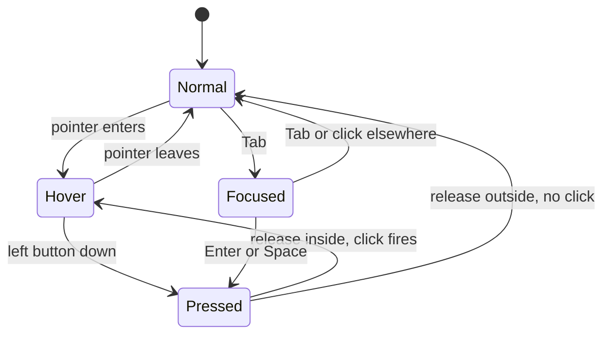
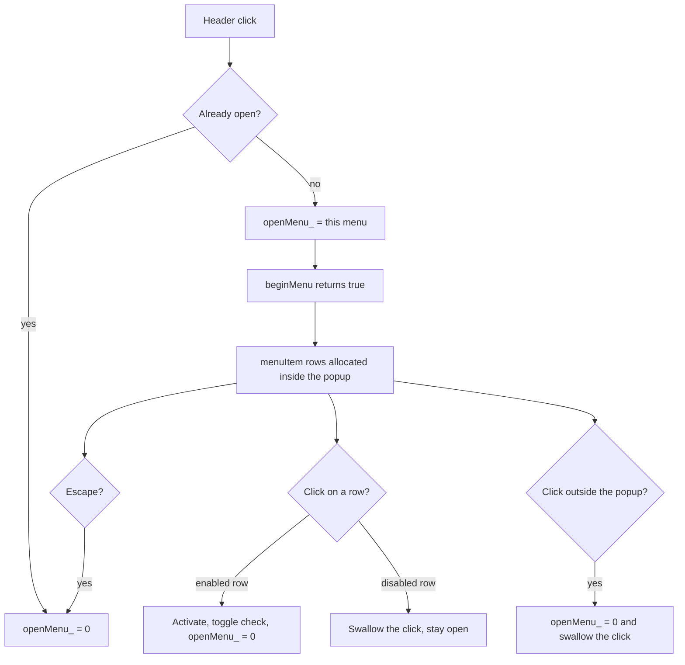
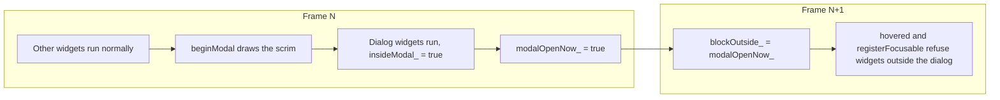

# Chapter 11. The widget catalogue: standard controls for a Win32 programmer

**You will learn**

- How the controls you know from Win32 (`BUTTON`, `EDIT`, `COMBOBOX`, `SysTreeView32`, menus, `MessageBox`) map onto immediate mode calls
- The recipe every control follows: rectangle, interaction, state to colours, paint, focus ring
- How menus, context menus, tooltips and modal dialogs work when there are no windows and no messages
- How a tree view keeps its open and closed state without nodes
- What the toolkit still cannot do, so you know where to extend it

**Code for this chapter:** `lib/ui/src/ui_controls.cpp` (531 lines), the declarations at the end of `lib/ui/include/ww/ui.hpp`, `p10_controls/controls.hpp` (the demo as one function), and `tests/controls_test.cpp`.

**Prerequisite:** chapter 10. This chapter assumes you know ids, hot, active and focus, the layout stack and deferred overlays. If `dropdown()` in `ui.cpp` still looks strange to you, reread section 10.10 first.

---

## 11.1 From HWNDs to function calls

In Win32 every control is a child window. You create it once, the system keeps it alive, and it talks to you with messages.

```cpp
// Win32: create once...
HWND save = CreateWindowExW(0, L"BUTTON", L"Save", WS_CHILD | WS_VISIBLE | BS_PUSHBUTTON,
                            10, 10, 80, 30, parent, (HMENU)IDC_SAVE, hInstance, nullptr);

// ...react in the window procedure, whenever it happens
case WM_COMMAND:
    if (LOWORD(wParam) == IDC_SAVE) save();
    break;
```

Here there is no handle, no id constant and no window procedure. The control exists for exactly as long as the call runs.

```cpp
// ww: describe it every frame, and act on the result
if (ui.button("Save")) save();
```

The differences matter when you port a mental model:

| Win32 | This toolkit |
|---|---|
| A control is an `HWND` with a class, styles and a parent | A control is one function call inside the build function |
| State lives inside the control (`BM_GETCHECK`, `LB_GETCURSEL`, `WM_GETTEXT`) | State lives in your variables, passed by reference (`ui.checkbox("x", flag)`) |
| Notifications arrive as `WM_COMMAND` or `WM_NOTIFY` | The function returns `true` (or the new value is already in your variable) |
| Position is set with `MoveWindow`, or a dialog template | Position comes from the layout stack, call order decides |
| `WM_PAINT` and visual styles draw it, or you owner draw it | The call draws it, always. "Owner draw" is the only mode there is |
| Focus order follows the Z order and `WS_TABSTOP` | Focus order is call order |
| Hiding a control: `ShowWindow(h, SW_HIDE)` | Do not call it |
| Disabling: `EnableWindow(h, FALSE)` | Wrap the call in `beginDisabled()` / `endDisabled()` |

Two consequences are worth saying early.

1. **You cannot "get at" a control later.** There is nothing to hold. If a menu item needs to be disabled, you pass the condition when you call it, every frame.
2. **Controls are cheap to add and remove.** A list that grows, a panel that appears when a checkbox is ticked, a tree that is built from a data structure: all are just `for` and `if`.

## 11.2 The catalogue: Win32 control to toolkit call

This table is the reference for the rest of the chapter. "Stage" is where the control was introduced.

| Win32 | Toolkit call | Drawn as | Stage |
|---|---|---|---|
| `STATIC` (label) | `label(text, style)` | Text, no interaction | 8 |
| `BUTTON` (push button, default button) | `button(text, primary)` | Rounded rectangle, accent colour when primary | 8 |
| `BUTTON` with `BS_AUTOCHECKBOX` | `checkbox(text, bool&)` | 18 px box with a check mark | 8 |
| `BUTTON` with `BS_AUTORADIOBUTTON` | `radio(text, int&, value)` | Circle with a dot | 8 |
| `BUTTON` with `BS_GROUPBOX` | `beginCard(title)` / `endCard()` | Panel with a heading | 8 |
| `EDIT` (single line) | `textField(id, string&, hint)` | Inset box, caret, selection | 8 |
| `COMBOBOX` (`CBS_DROPDOWNLIST`) | `dropdown(id, items, int&)` | Header plus popup overlay | 8 |
| `LISTBOX` | `listBox(id, items, int&, rows)` | Clipped rows with a scroll bar | 8 |
| `msctls_trackbar32` | `slider(id, float&, min, max)` | Track, fill and knob | 8 |
| `msctls_progress32` | `progressBar(fraction, text)` | Rounded bar | 8 |
| `SysTabControl32` | `tabBar(id, names, int&)` | Header strip with an underline on the selected tab | 8 |
| `SCROLLBAR`, `WS_VSCROLL` | `beginScroll(id, height)` / `endScroll()` | Clipped area with a draggable thumb | 8 |
| `msctls_updown32` with an edit buddy | `spinBox(id, int&, min, max, step)` | Value box with two small buttons | **10** |
| `SysTreeView32` | `treeNode`, `treeLeaf`, `treePop` | Rows with disclosure triangles and indentation | **10** |
| `CreateMenu` and the menu bar | `beginMenuBar`, `beginMenu`, `menuItem`, `menuSeparator` | Strip of headers, popup per menu | **10** |
| `TrackPopupMenu` (context menu) | `beginContextMenu(id)` | Same popup, opened at the mouse | **10** |
| `tooltips_class32` | `tooltip(text)` | Small overlay near the pointer after a delay | **10** |
| `MessageBox` | `messageBox(title, text, buttons, open)` | Modal dialog with a row of buttons | **10** |
| `DialogBox` (modal dialog) | `beginModal(title, open)` / `endModal()` | Scrim, panel, your widgets inside | **10** |
| `msctls_statusbar32` | `statusBar(panes)` | Strip pinned to the bottom edge | **10** |
| Accelerator tables | `shortcut(key, ctrl, shift, alt)` | Not drawn, consumes a key press | **10** |

Not covered by this toolkit, with the reason:

- `SysListView32` (report view with columns, sortable headers): a table needs column layout and virtualisation. Exercise 11.8 sketches it.
- Multi line `EDIT` and `RichEdit`: needs line layout, two dimensional caret movement and scrolling. Exercise 10.6 started this.
- `ToolbarWindow32`, `ReBarWindow32`: toolbars are a row of buttons with icons. There is no icon support yet.
- Submenus, menu mnemonics (`&File`, Alt+F): the data model allows them, the code does not implement them. Exercise 11.5.
- Accessibility (UI Automation on Windows, AT-SPI on Linux): see chapter 13.

## 11.3 The recipe every control follows

Every control in `ui.cpp` and `ui_controls.cpp`, from the button to the tree, is the same five steps. Learn them once and you can write a new control in an evening.

1. **Allocate a rectangle** from the layout (`allocate(naturalWidth, height)`), or compute one yourself.
2. **Run the interaction**: hover test, press, release, keyboard. This produces the return value.
3. **Map state to colours**: normal, hover, pressed, focused, disabled, selected.
4. **Paint** background first, then content, so later pieces cover earlier ones.
5. **Draw the focus ring last**, and only for the focused, enabled control.

The button is the shortest complete example. This is nearly its whole body:

```cpp
bool Context::button(std::string_view labelText, bool primary) {
    const Id id = makeId(labelText);
    const std::string_view shown = displayText(labelText);   // "Save##2" shows "Save"
    const TextSize ts = measure(shown, theme_.font);
    const Rect r = allocate(std::ceil(ts.width) + 32, theme_.rowHeight);        // 1

    bool hover = false, held = false;
    bool clicked = clickBehavior(id, r, hover, held);                            // 2
    registerFocusable(id);
    if (focused(id) && enabled() && (consumeKey(Key::Enter) || consumeKey(Key::Space))) clicked = true;

    Color fill = primary ? (held ? theme_.accentPressed : hover ? theme_.accentHover : theme_.accent)
                         : (held ? theme_.widgetPressed : hover ? theme_.widgetHover : theme_.widget);   // 3
    renderer_->fillRoundRect(r, theme_.radius, dim(fill));                       // 4
    drawText(r, shown, dim(primary ? theme_.textOnAccent : theme_.text), true);
    if (focused(id) && enabled()) drawFocusRing(r, theme_.radius);              // 5
    return clicked;
}
```

The visual states of a push button form a small state machine. The same shape, with different colours, applies to checkboxes, radio buttons, tabs and menu headers.



A Win32 programmer will recognise `Normal`, `Hover` (`BST_HOT`), `Pressed` (`BST_PUSHED`) and `Focused` (`BST_FOCUS`). The difference is that there is no stored bit: `hover` and `held` are recomputed from the mouse position and the active id on every frame.

**Disabled** is not a state of the button but of the call. `dim(color)` fades any colour while `disabledDepth_ > 0`, and `clickBehavior` returns false for disabled widgets, so a single `beginDisabled()` handles a whole group. The demo uses it for the Save button:

```cpp
if (!s.dirty) ui.beginDisabled();       // nothing to save
const bool saveClicked = ui.button("Save");
if (!s.dirty) ui.endDisabled();
if (saveClicked) { s.action = "Saved"; s.dirty = false; }
```

## 11.4 Menus

A menu bar looks like one control but is really three things working together: a strip of headers, one open popup, and a set of items. The API mirrors how the user sees it:

```cpp
if (ui.beginMenuBar()) {
    if (ui.beginMenu("File")) {                       // true only while this menu is open
        if (ui.menuItem("Open...", "Ctrl+O")) openFile();
        if (ui.menuItem("Save", "Ctrl+S", nullptr, dirty)) save();   // last argument: enabled
        ui.menuSeparator();
        if (ui.menuItem("Exit")) quitAsk = true;
        ui.endMenu();
    }
    if (ui.beginMenu("View")) {
        ui.menuItem("Word wrap", {}, &wordWrap);      // a bool pointer makes it checkable
        ui.endMenu();
    }
    ui.endMenuBar();
}
```

If the menu is closed, `beginMenu` draws the header and returns `false`, so the item calls do not run. That is the immediate mode version of "the menu is not built until it is shown".

### One open menu, owned by the context

There is a single `openMenu_` id. Clicking a header sets it (or clears it when clicking the open one). Everything else follows:



Three rules make it behave like the menus users expect.

**Hover switching.** Once one bar menu is open, moving the pointer onto another header opens that one instead. The code only does this when the pointer actually moved:

```cpp
} else if (hover && input_.moved && openMenu_ != 0 && openMenu_ != id && openMenuIsBar_) {
    openMenu_ = id;
```

Without `input_.moved`, a pointer resting on the File header would undo the Right arrow key on every frame, because the header "wins" the hover test again. This was a real bug found by the tests (`testMenuKeyboard`). Whenever you let the mouse and the keyboard drive the same state, ask which of them is allowed to act when neither changed.

**Keyboard.** `endMenuPopup` handles Down and Up (wrapping), `endMenuBar` handles Left and Right between headers, and `menuItem` checks Enter on the highlighted row. All use `consumeKey`, so the keys do not also reach a focused button behind the menu. Opening a menu clears `focusId_` for the same reason.

**Swallowing clicks.** A click that closes a menu must not also press whatever lies underneath. The code sets `pressClaimed_ = true`, the same flag every widget uses to say "this press is mine".

### Popups are built from last frame's size

The popup background is drawn as an overlay (after everything else), but its size depends on the items, which are only known after the last `menuItem`. Cards had the same problem in section 10.6 and the solution is the same: remember the size from the previous frame, and ask for another pass when it changed.

```cpp
const float w = std::max(mb_.widest, 150.0f);
const float h = (mb_.y - mb_.popup.y) + 4;
auto& stored = menuSizes_[mb_.id];
if (std::abs(stored.first - w) > 0.5f || std::abs(stored.second - h) > 0.5f) needsRedraw_ = true;
stored = {w, h};
```

Each `menuItem` pushes its own overlay lambda, so a row is drawn with the theme and highlight state it had when it was submitted. The background lambda is pushed first (in `beginMenuPopup`), so rows paint over it.

### Blocking the widgets underneath

While a popup is open, a click inside it must not reach a button below. `hovered()` refuses points inside the popup rectangle. There is a subtlety: a context menu is built *after* the widget it belongs to (it needs `lastRect()` of that widget), so the list box has already run its hit test by the time the popup exists in this frame. The fix is to remember the previous frame's popup:

```cpp
if (popupOpenNow_ && popupRect_.contains(mx, my)) return false;       // popup built earlier this frame
if (prevPopupActive_ && prevPopupRect_.contains(mx, my)) return false; // popup built last frame
```

The first version of this chapter's demo had exactly this bug: choosing "Add item" from the context menu also selected the list row underneath. The screenshot gave it away (the selection had moved), the second line above fixed it.

### Context menus and shortcuts

A context menu is the same popup, opened at the mouse when the most recent widget is right clicked:

```cpp
ui.listBox("items", items, selected, 4);
if (ui.beginContextMenu("listctx")) {
    if (ui.menuItem("Add item")) items.push_back("New");
    ui.menuItem("Remove selected", {}, nullptr, selected >= 0);
    ui.endContextMenu();
}
```

The shortcut text in a menu item (`"Ctrl+S"`) is only displayed. Windows has accelerator tables for the keys themselves, and here that job is `shortcut()`, which consumes a matching key press:

```cpp
if (ui.shortcut(ww::Key::S, /*ctrl=*/true) && dirty) save();
```

Call it at the top of the build function, before any widget that owns the keyboard (a focused text field swallows everything). Keeping the label and the key in two places is the price of having no menu objects. If it bothers you, wrap both in one helper that takes a struct `{label, key, ctrl}`.

## 11.5 Tooltips

A tooltip is a rule: *the pointer has rested on this widget for N milliseconds, so show some text*. The call comes right after the widget, like `lastHovered()` in chapter 10:

```cpp
if (ui.button("Open", true)) openFile();
ui.tooltip("Open a file (Ctrl+O)");
```

`tooltip` identifies the widget by hashing its rectangle, starts a timer when that identity changes, and pushes an overlay once the delay passed. One piece is easy to miss: a program that sleeps in `waitEvent(-1)` would never wake up to show the tooltip, because no event arrives while the mouse is still. So the call also reports how long it still has to wait:

```cpp
const int remaining = static_cast<int>(tipDelayMs_ - waited);
tipWakeMs_ = tipWakeMs_ < 0 ? remaining : std::min(tipWakeMs_, remaining);
```

and `nextWakeupMs()` returns the smaller of that and the caret blink time. This is the same mechanism the text field uses (section 10.9). The event loop did not change at all, which is the point of `nextWakeupMs`.

A tooltip hides while a button is held (`input_.down[0]`), because it would otherwise cover the thing the user is pressing. In tests the delay is set to zero with `setTooltipDelayMs(0)`; `testTooltipDelay` keeps the real delay and checks the wake up request instead of waiting.

## 11.6 Modal dialogs

`MessageBox` blocks the thread until the user answers. Immediate mode has no thread to block, so a modal dialog is a *state*: while a bool is true, the dialog is drawn and everything else is inert.

```cpp
bool quitAsk = false;                   // your state
...
const int answer = ui.messageBox("Quit?", "Leave the program?\nNothing has been saved.",
                                 {"Quit", "Stay"}, quitAsk);
if (answer == 0) running = false;       // index of the clicked button, -1 while undecided
```

`messageBox` is built on the general form, which accepts any widgets:

```cpp
if (ui.beginModal("Rename", renameOpen, 420)) {
    ui.textField("newname", name);
    if (ui.button("OK", true)) { rename(name); renameOpen = false; }
    ui.endModal();
}
```

### Two things make it modal



1. **The scrim.** A translucent black rectangle over the whole window, drawn when `beginModal` is called. Because drawing order is call order, everything called earlier ends up dimmed and everything called later (the dialog) is on top. So **call dialogs last** in the build function.
2. **`blockOutside_`.** At the start of each frame it is set from what was drawn in the previous one. While it is true, `hovered()` returns false and `registerFocusable()` ignores the widget unless `insideModal_` is set. Hover, clicks, scroll wheel and Tab order all go through those two functions, so the window behind is dead without touching any widget code.

Why use last frame's state instead of this frame's? The widgets behind the dialog are called *before* the dialog is, so at the moment they run the program cannot know a dialog is coming. One frame of lag is invisible, and `drawFrame` runs two passes after input anyway.

Escape closes the dialog by setting your bool to false. The dialog height is measured late like card heights (`modalHeights_`), so it is centred correctly from the second pass on.

Compare with Win32: `DialogBox` runs a nested message loop and returns when `EndDialog` is called, which is simple to use but means your code is suspended in the middle of a function. The immediate mode version returns every frame, and your program stays responsive (it can still repaint, receive close events or time out).

## 11.7 Tree view

`SysTreeView32` stores items inside the control (`TVM_INSERTITEM`, `HTREEITEM`). Here the tree is your data, and drawing it is a recursive function:

```cpp
void drawNode(ww::ui::Context& ui, State& s, const Node& n, int& counter) {
    const int myId = counter++;
    const auto row = ui.treeNode(n.name, /*selected=*/s.selectedNode == myId);
    if (row.clicked) s.selectedNode = myId;
    if (row.open) {
        for (const Node& child : n.children) drawNode(ui, s, child, counter);
        ui.treePop();
    } else {
        for (const Node& child : n.children) counter += countNodes(child);   // keep ids stable
    }
}
```

The contract has three parts.

- `treeNode` draws a row and returns `{open, clicked}`. If `open`, you draw the children and then call `treePop()`.
- `treeLeaf` is a row with no arrow. It only returns whether it was clicked, and needs no pop.
- The *only* state the context keeps is one bool per node: open or closed, in `treeOpen_`, keyed by node id.

**Ids and indentation.** When a node is open, `treeRow` does two things: it indents the layout (`l.x += 18; l.bounds.w -= 18`) and pushes the node's id onto the id stack. `treePop` undoes both. Pushing the id means that two nodes named `README.md` in different folders get different ids, and so different open flags. The indent is the entire "tree layout".

**Selection.** Selection is yours. The demo numbers the nodes in traversal order and stores that number. Note the `else` branch in the code above: when a node is closed, the counter must still skip its hidden descendants, otherwise the id of every later node changes when you collapse a folder, and the selection jumps. The test `testTree` checks this explicitly.

**Clicks.** A click on the arrow (the leftmost 20 px) toggles. A click on the label selects. A double click on the label toggles, like Explorer. `defaultOpen` (the third parameter) only matters the first time a node is seen: the demo opens the root and leaves the rest closed.

A tree inside `beginScroll` works unchanged, because the scroll area is also a vertical layout.

## 11.8 Spin box and status bar

**Spin box.** `msctls_updown32` is normally paired with an edit control as its "buddy". The toolkit's version is simpler: a read only value box with two buttons.

```cpp
if (ui.spinBox("copies", copies, 1, 20)) markDirty();
```

It responds to the up and down buttons, the arrow keys and Page Up and Page Down (step times ten), Home and End (minimum and maximum), and the mouse wheel. The value is clamped to the range every frame, so you can write `copies = 500` in your code and the widget repairs it. Typing a number is not supported (exercise 11.4).

**Status bar.** `statusBar({"Ready", "Copies: 3", "Modified"})` fills a strip at the bottom edge, with separators between panes. It does not use the layout stack at all; it asks the renderer for the window height and draws there. The consequence is that it does not push the content up, so leave room yourself, as the demo does by keeping its cards short. Because it is drawn immediately, call it near the end of the build function and before dialogs.

## 11.9 Stage 10: the controls demo

`p10_controls/controls.hpp` is a small file-manager style window that uses every control from this chapter and several from chapter 10. Its shape:

```text
+--------------------------------------------------------------+
| File   View   Help                              (menu bar)   |
+--------------------+-----------------------------------------+
| Project            | Controls                                |
|  v linux-windowing |  [Open] [Save]      (tooltips)          |
|    v src           |  Copies [ 1 ^v]     (spin box)          |
|        main.cpp    |  [x] Notifications                      |
|    > include       |  ( ) Low (o) Medium ( ) High            |
|    > docs          |  ----o------------  (slider)            |
|      README.md     |  [#####-----] 35%   (progress)          |
|   (tree view)      | List and combo box                      |
|                    |  Alpha / Bravo / ... (right click)      |
+--------------------+-----------------------------------------+
| Clicked main.cpp | Selected: main.cpp | Copies: 1 | Saved    |
+--------------------------------------------------------------+
```

Run it with `make run-p10`. Try these:

- Open the File menu, then move across to View without clicking. Press Escape.
- Press Ctrl+N, Ctrl+S, Ctrl+Q. Which of them do nothing, and why?
- Hover the Open button and wait. Then press and hold it.
- Right click the list and choose Add item. Right click it again and choose Remove selected until the list is empty. What happens to the menu item?
- Open Help, About, and try clicking the check box behind the dialog.
- Resize the window narrower and see which parts reflow.

`--screenshot` works as in stage 8: `./p10_controls --screenshot out/p10` writes five PNGs (tooltip and tree, File menu, View menu, context menu, About dialog) without a window.

### Testing controls that only exist while open

A menu item does not exist until its menu is open, which complicates tests that need to click on it. The demo records the rectangle of everything it draws:

```cpp
inline void rec(State& s, ww::ui::Context& ui, const char* name) { s.rects[name] = ui.lastRect(); }
...
if (ui.menuItem("New", "Ctrl+N")) { ... }
rec(s, ui, "File/New");
```

and clears the map at the start of every build, so `state.rects.count("File/New")` doubles as "is that menu open". `tests/controls_test.cpp` then reads like a user story:

```cpp
f.click("File");
CHECK(f.h.context().menuOpen());
f.click("File/New");
CHECK(f.state.action == "New document");
CHECK(!f.h.context().menuOpen());
```

The 18 tests cover: choosing items, closing on outside click, click through, disabled items, checkable items, hover switching, keyboard navigation, shortcuts, context menus, tooltips with and without the delay, modal blocking, Escape, the quit dialog, tree expand, select and collapse, spin box, and a scale 2 run. Run them with `make test`, and under AddressSanitizer with `make test-asan`.

## 11.10 Limits, and what to build next

Everything below is a deliberate omission to keep the code short enough to read:

- **Submenus.** `menuItem` would need to open a second popup beside the row and keep both alive. `openMenu_` would become a small stack.
- **Mnemonics and Alt.** `&File` underlines a letter and Alt+F opens the menu. Needs `Key` plus modifier handling in `beginMenu`, and drawing the underline.
- **Keyboard navigation in trees.** Up and Down to move, Left and Right to collapse and expand, Home and End.
- **Nested modals and focus return.** One modal at a time works. Returning focus to the control that opened the dialog is not done.
- **Multi line text, list view, toolbars with icons.** See section 11.2.
- **Right to left layouts and accessibility.** See chapter 13.

None of these needs a new idea. They need more of the same recipe from section 11.3.

## Pitfalls

- **Calling the dialog before the widgets it should cover.** The scrim only dims what was already drawn. Always call `messageBox` and `beginModal` last.
- **Forgetting `endMenu()` or `treePop()`.** Unbalanced calls leave the popup half built or the layout indented. `treePop` is only called when `treeNode` returned `open == true`.
- **Calling `tooltip()` after something other than the widget.** It uses `lastRect()`. Any widget, including a `label`, in between changes what the tooltip belongs to.
- **Calling `beginContextMenu()` after the wrong widget**, for the same reason.
- **Building the context menu before the widget it belongs to.** The right click is tested against the most recent widget, so the order matters.
- **Reusing ids across the two menus.** `menuItem` labels do not need to be unique, but `beginMenu` labels and `beginContextMenu` ids do.
- **Changing tree node ids when the tree changes.** Ids that depend on position (as in the demo's counter) move when you insert a node, and the selection moves with them. For a real application, select by a stable key (a path or a database id) and compare that.
- **Expecting `shortcut()` while a text field has focus.** The field takes all keys. Call `shortcut` earlier in the build function, and only for combinations (with Ctrl or Alt) that are not text.
- **Counting on modal protection for keyboard shortcuts.** `shortcut()` is not blocked by a dialog. Check your own `aboutOpen` flags if the shortcut should not work while a dialog is up.

## Review questions

1. In Win32, where does the check state of a checkbox live, and where does it live in this toolkit? What does that change about how you disable a group of controls?
2. Why does `beginMenu` return `false` for a closed menu, and what would break if it always returned `true`?
3. A user opens the File menu with the mouse and presses the Right arrow key, but the View menu does not open. Describe the bug in section 11.4 that causes this, and the one flag that prevents it.
4. Why must a dialog be drawn last in the frame? What does `blockOutside_` add, given that the scrim already covers the other widgets?
5. A modal dialog appears in frame N. In which frame do the widgets behind it first stop reacting, and why is that acceptable?
6. A folder in the tree is collapsed, and the user then selects a file below it in another folder. Explain what goes wrong if the `else` branch with `countNodes` is removed.
7. Why does `tooltip()` report `tipWakeMs_`, and which function consumes it?
8. A context menu is built after its widget, but the click on a menu row must not reach that widget. How does `hovered()` achieve that?

## Exercises

**Ex 11.1** Add a menu item with a keyboard accelerator that works without writing the key twice: a helper `bool Context::menuCommand(label, Key key, bool ctrl)` that shows "Ctrl+X" automatically and also fires when the key is pressed. Use it for New, Save and Exit in the demo.

**Ex 11.2** Make Left and Right in the tree collapse and expand the selected node, and Up and Down move the selection. Which state must the toolkit keep that the application owns today? (Hint: a focused tree needs an id for `registerFocusable`, and a way to know the neighbours.)

**Ex 11.3** Add `ui.toolbarButton(id, glyph)`, a square 32 px button that shows one character from a symbol font (for example from the DejaVu Sans symbols), with a tooltip. Build a toolbar row from five of them.

**Ex 11.4** Let the spin box be typed into. Sketch the design: it needs the text field's editing code with a string buffer that is parsed on every change and when focus leaves. What happens to the buffer while the user types "-" or an empty string?

**Ex 11.5** Implement submenus. A `beginSubMenu(label)` row that opens a second popup to the right of the row when hovered for 250 ms, and closes it when the pointer leaves both. What should `openMenu_` become?

**Ex 11.6** Add an "OK / Cancel" `Rename` dialog to the demo using `beginModal` with a `textField`. Pressing Enter in the field should press OK. What do you do about the initial focus?

**Ex 11.7** Measure: use the pass counter from exercise 10.7. How many passes does it take to open the File menu the first time, and the second time? Explain the difference using `menuSizes_`.

**Ex 11.8** (Hard) Design a `listView(id, columns, rows, int& selected)` with a header row, resizable columns and click-to-sort headers. List the state the context must keep per list view, and decide whether rows are drawn by a callback or from a table of strings. Implement the table of strings version.

Solutions: [solutions/ch11.md](solutions/ch11.md)

Previous: [Chapter 10](10-immediate-mode-ui.md) | Next: [Chapter 12, building and testing an application](12-building-and-testing-an-app.md)
