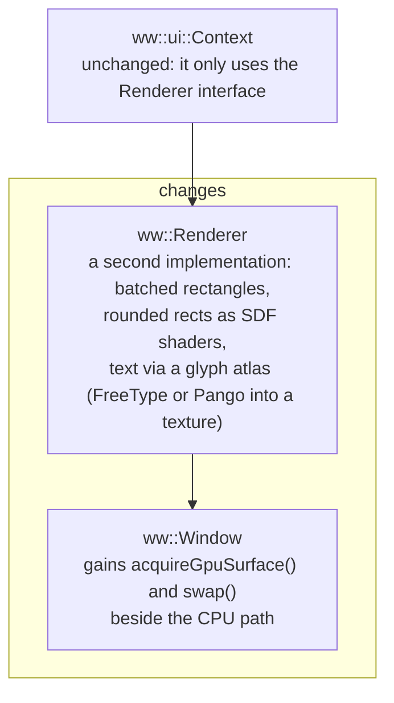

# Chapter 13. Where to go next

**You will learn**

- What this codebase deliberately leaves out, and why each gap matters
- How each missing piece works at the protocol level, so you can build it
- A suggested order to tackle them
- How to package and ship a Linux application

This chapter is a map, not a tutorial. For each topic you get the idea, the protocols or libraries involved, and a first step.

---

## 13.1 Known limitations of the code in this repository

| Area | Current state |
|---|---|
| Text input | No input method (IME), no compose or dead key handling beyond what xkbcommon gives for plain keys |
| Clipboard | Text only. No INCR on X11, no PRIMARY selection, synchronous read with a 500 ms limit |
| Drag and drop | Not implemented |
| Wayland scaling | Integer scale only |
| Pointer | No smooth scrolling on X11 (no XInput2), no touch, no pen |
| Windows | One top level window, no popups or child windows as real windows |
| Accessibility | None |
| Rendering | CPU only |
| Text editing | Code point movement, no grapheme clusters, no bidirectional editing, single line only |
| Wayland testing | Pointer, keyboard and the drawn title bar were reviewed and compiled, not exercised on a live compositor |

None of this is hidden. A real application needs most of it, so here is how each is done.

## 13.2 Input methods (IME)

For Chinese, Japanese, Korean and many other languages, the user types a sequence of keys that is *composed* into characters, with a candidate list. The application cannot get that from key events alone. It needs an **input method**.

**Wayland** uses the `text-input-v3` protocol. The client:

1. Binds `zwp_text_input_manager_v3`, creates a text input for the seat.
2. Calls `enable()` when a text field gets focus, and `disable()` when it loses it.
3. Tells the input method where the caret is (`set_cursor_rectangle`) so it can place its candidate popup, and what text surrounds the caret (`set_surrounding_text`).
4. Receives `preedit_string` (the not yet committed text, which you draw underlined), `commit_string` (final text to insert) and `delete_surrounding_text`.
5. Applies the changes in `done`, with the serial protocol described in the spec.

**X11** uses XIM (old) through Xlib (`XOpenIM`, `XCreateIC`, `XmbLookupString`, with `XFilterEvent` on every event), or talks to IBus or Fcitx through their libraries.

The toolkit change: the text field must be able to display a **preedit** range and report its caret rectangle. The platform layer gains a `ImeEvent{preedit, commit}` and a `setImeRect(Rect)` function. Start by implementing **compose and dead keys** only (xkbcommon has `xkb_compose_*` functions), which covers European accents, before attempting full IME.

## 13.3 Better clipboard and drag and drop

- **INCR (X11).** Selections larger than the server's maximum request size are sent in chunks. The requestor sets a property of type `INCR`, then repeatedly reads and deletes a property while the owner appends. It is a small state machine driven by `PropertyNotify` events.
- **PRIMARY.** Select text to copy, middle click to paste. On X11, same code as CLIPBOARD with a different atom. On Wayland, the `primary-selection` protocol.
- **More formats.** Offer `text/uri-list` for files and `image/png` for images, and pick the best from the offer list when pasting.
- **Async paste.** Return immediately and deliver the text as an event (chapter 8, Ex 8.5).
- **Drag and drop.** X11 uses the XDND protocol with client messages and selections. Wayland uses `wl_data_device` with `enter`, `motion`, `drop` events and the same offer mechanism as the clipboard. Plan a unified event: `DropEvent{position, formats}` with a function to fetch the data.

## 13.4 Fractional scaling and sharp HiDPI on Wayland

Integer scaling blurs at 125 or 150 percent. Modern compositors offer:

- **`wp-fractional-scale-v1`**: the compositor tells the client its preferred scale as a number in 120ths (for example 180 for 1.5).
- **`wp-viewporter`**: the client renders a buffer of any size and tells the compositor to display it at a given logical size (`wp_viewport.set_destination`).

Combine them: render at `ceil(logical * scale)` pixels, set `buffer_scale` 1, and set the viewport destination to the logical size. Your `Framebuffer.scale` is already a float, and the renderer already works with a float device scale, so most of the code already supports it. The change is in `wayland_window.cpp`: replace the integer `scale_` with the fractional value and use a viewport.

Also use `wl_surface.preferred_buffer_scale` (surface version 6) to be told the scale directly, instead of computing it from outputs.

## 13.5 Smooth scrolling, touch and tablets

- **X11:** XInput2 (`XISelectEvents`, `XI_Motion`, `XI_ButtonPress`, valuators for scroll). It gives smooth scrolling, high resolution wheels, and touch.
- **Wayland:** `wl_pointer.axis_value120` and `axis_source` for scrolling, `wl_touch` for touch, and the tablet protocol for pens.
- Your `ScrollEvent` already carries floating point `dx`, `dy`. Add `source` (wheel or finger) to decide whether to animate.

## 13.6 Accessibility

A UI made of drawn pixels is invisible to screen readers. On Linux, accessibility goes through **AT-SPI** over D-Bus. An application exposes a tree of accessible objects (role, name, state, bounds, actions), and the screen reader walks it.

For an immediate mode toolkit this means that every frame the toolkit also emits a **semantic description** of what it drew: a button named "Save" with these bounds, a text field with this content and caret. Libraries such as AccessKit (Rust, with C bindings) take that description and speak AT-SPI for you. This is a big topic, and it is the single most important feature missing from nearly every hand written UI. Design for it early: give every widget a role and a name in `ui.cpp`.

## 13.7 More windows

- **Popups and menus.** In Wayland these are `xdg_popup` surfaces positioned relative to a parent by an `xdg_positioner`, and they are *grabbed* so a click outside dismisses them. In X11 they are override-redirect windows. Our dropdown draws inside the main window, which is simpler and cannot extend beyond the window edge.
- **Dialogs.** `xdg_toplevel_set_parent` makes a child window. On X11 use `WM_TRANSIENT_FOR`.
- **Multiple top level windows.** `Window::create` can be called more than once, but the event loop must then wait on all of them. A shared `waitEvent` over a list of windows, keyed by an id in each event, is the natural change.
- **System tray, notifications, file chooser.** These go through D-Bus and the **XDG desktop portals** (`org.freedesktop.portal.*`), which also work for sandboxed apps.

## 13.8 GPU rendering (the optional stage 11)

The CPU path draws each pixel in software and copies the frame. It is perfectly good for a settings dialog or an editor. It becomes limiting for large windows at high refresh, heavy animation, or many layers.

**EGL and OpenGL.** Create an EGL display from the native connection (`eglGetPlatformDisplay` with `EGL_PLATFORM_X11_KHR` or `EGL_PLATFORM_WAYLAND_KHR`), choose a config, create a window surface from an X11 `Window` or a Wayland `wl_egl_window`, create a context, and call `eglSwapBuffers` instead of `present`. On Wayland the swap does the attach and commit for you.

**Vulkan.** `VK_KHR_xlib_surface`, `VK_KHR_wayland_surface`, a swapchain, command buffers. More setup, more control, and the same idea.

What changes in the layers:

This is why chapter 9 insisted on a narrow renderer interface. The UI code you wrote would not change. Expect the glyph atlas and the clipping (use scissor rectangles) to be the hard parts. Frame pacing also improves: the swap interval ties to the display refresh.

A pragmatic middle path: keep CPU rendering for the UI and add a GPU canvas widget for the part that needs it (a 3D view, a video).

## 13.9 Better text

- **Grapheme clusters.** Move the caret by user perceived character (a letter plus combining marks, a flag, a family emoji). Use `pango_layout_move_cursor_visually`, or ICU's `BreakIterator`, or `libgrapheme`.
- **Bidirectional text.** In mixed Arabic and English text, the visual order differs from the logical order, and the arrow keys must move visually. Pango provides the primitives.
- **Multi line editing, wrapping and scrolling,** with `pango_layout_set_width`.
- **Rich text** with Pango markup or attribute lists.
- **Undo and redo.** Keep a stack of edits (insert and delete operations) and merge consecutive typing into one undo step.

## 13.10 Performance

- **Damage tracking.** Redraw and upload only changed regions (`wl_surface_damage_buffer` with a smaller rectangle, `XShmPutImage` with a sub rectangle).
- **Cache text.** Keep `PangoLayout`s or rendered text bitmaps for strings that did not change.
- **Skip frames.** Detect that nothing visible changed (the same hot id, the same values) and skip the redraw. This is Ex 10.7.
- **Measure before optimising.** `perf record`, flame graphs, and a frame time counter on screen.

## 13.11 Packaging and desktop integration

A program is not an application until the desktop knows about it.

- **A `.desktop` file** (`/usr/share/applications/yourapp.desktop`) with `Name`, `Exec`, `Icon`, `Categories` and `StartupWMClass` (or the Wayland app id). The app id you pass to `WindowConfig.appId` must match the desktop file name, or the desktop shows a generic icon.
- **Icons** in `hicolor` theme sizes, or an SVG.
- **Installing with CMake** (`install(TARGETS ...)`, `install(FILES ...)`) and **CPack** for `.deb` packages.
- **Flatpak, Snap, AppImage** for distribution. Under Flatpak you must use portals for file dialogs, and the sandbox's Wayland socket rules apply.
- **Settings and data** go in `$XDG_CONFIG_HOME` (default `~/.config/yourapp`) and `$XDG_DATA_HOME`. Never write next to the executable.

## 13.12 A suggested order

1. Test on a real Wayland session, fix what you find (chapter 12 checklist).
2. Compose and dead keys with `xkb_compose`.
3. Async clipboard, INCR, PRIMARY.
4. Fractional scaling.
5. Multi line text and grapheme aware editing.
6. Popup windows.
7. Accessibility tree.
8. Full IME.
9. GPU renderer.

Each step is a few days of work and each teaches a different area of the platform. Pick the one your application needs first.

## 13.13 Further reading

- *The Wayland Book* by Drew DeVault (free online at wayland-book.com).
- The `xdg-shell`, `xdg-decoration`, `text-input-v3`, `fractional-scale-v1` protocol XML files and their documentation, in the `wayland-protocols` repository.
- The X Window System Protocol and the ICCCM and EWMH specifications (freedesktop.org).
- The xkbcommon documentation and its quick guide.
- Cairo's tutorial and Pango's reference manual.
- Source code of small toolkits: the *Dear ImGui* source (its backends show how each platform is wired), and for Wayland `foot` or `wlroots` clients.
- Freedesktop specifications: Desktop Entry, Icon Theme, XDG Base Directory.

## Review questions

1. Name the three pieces of an IME exchange on Wayland (`preedit_string`, `commit_string`, and what else the client must send?).
2. What two Wayland protocols combine to give sharp fractional scaling?
3. Why does accessibility need a semantic description, and why is that harder for a toolkit that draws pixels?
4. What stays unchanged if you replace the CPU renderer with a GPU renderer, and why?
5. Which application id mismatch causes a generic icon?

## Exercises

**Ex 13.1** Add dead key and compose support for the text field using `xkb_compose_table_new_from_locale` and `xkb_compose_state_feed`. Test with Compose, `'`, `e` on X11 and Wayland.

**Ex 13.2** Implement the PRIMARY selection on X11: set it when text is selected in a text field, paste on middle click.

**Ex 13.3** Install the app: write `install()` rules and a `.desktop` file so that stage 9 appears in your applications menu with the right name.

**Ex 13.4** Add `wp-fractional-scale-v1` and `wp-viewporter` to `WaylandProtocols.cmake` (vendor the XML files) and implement fractional scaling in the Wayland backend. How do you verify it without a fractional display?

**Ex 13.5** Choose one feature from section 13.12 (the suggested order) and write a one page design: protocols, changes to each layer, tests, and risks.

Solutions: [solutions/ch13.md](solutions/ch13.md)

Previous: [Chapter 12](12-building-and-testing-an-app.md) | Next: [Appendices](appendix-b-cheatsheets.md)
